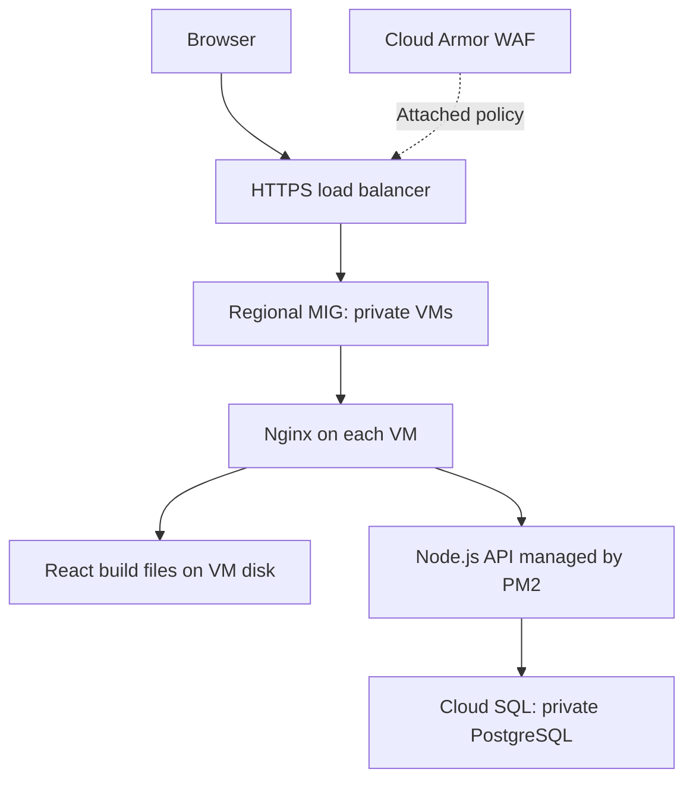

# Task Manager on Google Cloud

A React and Node.js task manager deployed on private Compute Engine VMs, backed by Cloud SQL PostgreSQL and delivered through Cloud Build.

This repository documents a hands-on cloud engineering project: provisioning a custom network, deploying a web application, protecting its public entry point, and troubleshooting the delivery pipeline. **The complete setup and operations documentation is included in this README.**

## What This Project Demonstrates

- A global HTTPS load balancer with managed TLS and Cloud Armor WAF rules.
- A regional Managed Instance Group running Nginx and Node.js on VMs without public IPs.
- Private PostgreSQL connectivity through Private Services Access.
- A GitHub-triggered pipeline that tests, packages, deploys and checks application readiness.
- Runtime credentials fetched from Secret Manager rather than committed to Git.
- Database administration through an IAP-backed SSH tunnel and a private bastion VM.
- Cloud NAT for external package repositories and Private Google Access for supported Google APIs.

## Technology Stack

| Layer | Technology |
|---|---|
| Frontend | React, served as static build files by Nginx |
| API | Node.js / Express, managed by PM2 |
| Database | Cloud SQL for PostgreSQL 15 |
| Compute | Compute Engine, regional Managed Instance Group |
| Network | Custom VPC, private VM addresses, Cloud NAT, Private Google Access |
| Public entry point | Classic external Application Load Balancer, managed TLS certificate |
| Request filtering | Cloud Armor SQL injection and XSS rules |
| Delivery | GitHub, Cloud Build default pool, Cloud Storage release artifacts |
| Administrative access | IAP, SSH / OS Login, bastion VM, PostgreSQL roles |

## Project Status and Validation

**Learning project — deployment retired.** The application was deployed and tested, then the GCP project was shut down on October 26, 2026 to avoid ongoing learning-environment costs. The project reported `DELETE_REQUESTED`; permanent deletion follows Google Cloud's retention process. There is no active public demo. Resource names beginning with `prod-` are naming examples, not a claim that this was a customer production environment.

| Check | Recorded result |
|---|---|
| Build and deployment | All 11 pipeline steps passed; observed duration: 3 minutes 13 seconds |
| Public HTTPS health | `/health` returned HTTP 200 |
| Load balancer backends | Both application VMs reported healthy on port 80 |
| Frontend | Task manager loaded and displayed tasks |
| SQL injection WAF test | Detected in preview, then blocked with HTTP 403 and confirmed in enforced-policy logs |
| XSS WAF test | Detected in preview; rule subsequently configured for enforcement |
| Continuous availability | Not established; transient 502 responses were observed during VM startup |

The readiness check now polls HTTPS up to 18 times and stops immediately on HTTP 200. It passed after about one minute in the successful run. Retrying verification does not by itself prevent user-facing errors during deployment.

**Runtime maintenance:** the recorded deployment uses Node.js 20, which reached end of support on April 30, 2026. The examples retain that tested version. Before using this setup for a new long-lived workload, test a supported LTS release and update the Cloud Build images and VM installer together. [Node.js release schedule](https://github.com/nodejs/Release#release-schedule).

## Engineering Decisions

| Decision | Reason and tradeoff |
|---|---|
| Private application VMs | Public requests enter through the load balancer; engineers use IAP for administration. |
| Nginx alongside the load balancer | The load balancer distributes traffic across VMs. Nginx serves frontend files and forwards API requests within each VM. |
| ZONAL database configuration in this guide | Reduces learning costs; no standby for automatic cross-zone database failover. Verify actual instance settings before changing them. |
| Versioned release artifacts and immutable templates | Each build has a distinct package and template, allowing a previous working template to be selected for rollback. |
| Default build pool, manual schema changes | The current pipeline does not need database access. Private build-to-database connectivity must be designed separately before automating migrations. |
| WAF preview before enforcement | Lets signature matches be reviewed before matching requests are blocked. WAF rules supplement application security controls. |

**Last documentation update:** October 26, 2026. The examples use placeholders for project identifiers, private database addresses, domains and user emails. No live credentials are required to understand this documentation.

---

## Before Running the Examples

This project was built for learning and its GCP project has been shut down. Follow these instructions in your own project if you want to reproduce the deployment; the original application is no longer offered as a live demo.

Replace `YOUR_PROJECT_ID`, `YOUR_GITHUB_USERNAME`, `app.example.com`, and the example email addresses with your own values before running commands. `app.example.com` is a documentation placeholder, not a live application URL. Resource names such as `prod-vpc`, `prod-db`, and `prod-app-mig` are reusable example names, not credentials.

Obtain the actual database private IP from your own project using Part 4.1. The tunnel examples use `$DB_PRIVATE_IP`; set it in the terminal where you open the tunnel. The CI/CD health URL in `cloudbuild.yaml` must also use your real application domain.

Do not commit populated `.env` files, passwords, API tokens, service-account key JSON files, database dumps, or screenshots containing credentials. Keep only placeholder examples in the repository. Deleting cloud resources does not make a reused credential safe to publish.

### Prerequisites

Use an existing GCP project with billing enabled, a GitHub repository containing the application, and a domain you control for HTTPS. The provisioning identity needs permission to enable APIs, create the listed resources and grant the documented IAM roles. An organization policy can impose additional restrictions.

Commands assume Bash in Cloud Shell or a local Bash terminal. A local database client is required for `psql` examples (`psql --version`); install PostgreSQL client tools if it is missing. The IAP tunnel and database client must run on the same machine. Keep the tunnel open in one terminal and run database commands in another. Application snippets must be integrated into your existing source; the sample Express route is not a complete standalone server.

## Table of Contents

1. [What We Are Building](#part-1)
2. [GCP Project Setup](#part-2)
3. [Networking — VPC, Subnets, NAT](#part-3)
4. [Database — Cloud SQL PostgreSQL](#part-4)
5. [Preparing Your Application](#part-5)
6. [Secret Manager — Storing Credentials Safely](#part-6)
7. [Service Account — What Your VMs Run As](#part-7)
8. [VM Instance Template](#part-8)
9. [Managed Instance Group](#part-9)
10. [Load Balancer + HTTPS + SSL + Cloud Armor WAF](#part-10)
11. [Firewall Rules](#part-11)
12. [CI/CD with Cloud Build](#part-12)
13. [Verification and Troubleshooting](#part-13)
14. [Improvements and Learning-Project Cleanup](#part-14)

---

<a name="part-1"></a>
## Part 1 — What We Are Building

The deployment has three paths: user requests, automated delivery, and database administration.

### The Architecture

The diagram below renders directly on GitHub. The editable source is `Task-Manager-Architecture-WAF.excalidraw`; include that file in the repository if you want readers to edit the drawing.



Cloud Build fetches GitHub source, tests and packages the app, uploads a release to Cloud Storage, and creates a new template for the MIG. Each new VM downloads its release and reads Secret Manager at startup. Cloud Build does not connect to the database.

Engineers use an IAP-backed SSH tunnel through `db-bastion` to the Cloud SQL private endpoint. The VMs and bastion have no public IPs. Cloud SQL runs in a Google-managed services network connected through Private Services Access.

### How Traffic Flows

When a user visits your app:

1. Their browser hits the **Cloud Load Balancer** IP address (the only thing exposed to the internet)
2. The Load Balancer terminates SSL (handles HTTPS). Its attached Cloud Armor policy evaluates the request before forwarding allowed traffic to one of your VMs
3. **Nginx** on the VM receives the request:
   - If it is a request for `/` or any frontend route → Nginx serves the React static build from `/opt/app/client/build` on that VM's boot disk
   - If it is a request for `/api/...` → Nginx forwards it to Node.js running on port 3000
4. For API requests, Node.js processes the request, queries **Cloud SQL** over a private connection when needed, and returns the response. After loading the frontend, React running in the browser makes separate `/api/...` requests to fetch task data
5. The response travels back through Nginx → Load Balancer → user

### Why Each Component Exists

| Component | Why we use it |
|---|---|
| **Cloud Armor WAF** | Checks application requests at the load balancer; SQL injection and XSS rules are tested in preview before blocking. |
| **Cloud Load Balancer** | Single entry point. Handles SSL. Distributes traffic across VMs. |
| **Managed Instance Group** | Auto-scales VMs up and down. Repairs failed VMs. Supports rolling updates; application health and readiness need separate configuration. |
| **Nginx** | Efficient static file server. Reverse proxy to Node.js. Handles HTTP properly. |
| **PM2** | Keeps Node.js running. Restarts it if it crashes. Manages logs. |
| **Cloud SQL** | Managed PostgreSQL. GCP handles backups and patching. This lower-cost setup is single-zone; regional HA is an optional upgrade. |
| **Secret Manager** | Secure credential storage. VMs fetch secrets at boot. No credentials committed to Git; the startup script writes a root-readable runtime environment file. |
| **Cloud NAT** | Lets VMs reach the internet (for package installs) without having a public IP. |
| **Bastion VM** | Tiny VM inside the VPC. Developers reach Cloud SQL through it over an IAP tunnel. No public IP. |
| **Private Google Access** | Access to supported Google APIs without a VM public IP. Public NAT also enables it for covered subnet ranges; IAM still applies. |
| **Cloud Build** | Automated CI/CD. Every push to main triggers a build and deploy. Schema changes remain manual in this project. |
| **IAP** | Identity-Aware Proxy. Lets engineers SSH into VMs without opening port 22 to the internet. |

### Deployment Boundaries

- **Not putting PostgreSQL on a VM** — You would have to handle backups, patching, replication, and failover yourself. Cloud SQL manages the database infrastructure for a charge. Our single-zone setup includes backups but does not include a regional HA standby.
- **Not giving VMs public IPs** — Every VM with a public IP is a potential attack surface. Application traffic arrives through the load balancer; authorized engineers can also use IAP SSH.
- **No credentials committed to Git** — Secret Manager supplies runtime credentials. The startup script writes a protected local environment file, and PM2 retains its process environment; protect VM access as well as Secret Manager access.
- **Deploy through instance templates** — SSH edits can leave VMs running different configurations. Application changes are delivered through versioned templates and rolling updates.
- **Not using the default VPC** — We use a custom VPC with deliberate subnet ranges and targeted firewall rules.

---

<a name="part-2"></a>
## Part 2 — GCP Project Setup

### 2.1 Install and Configure gcloud CLI

If you have not installed the gcloud CLI yet:

```bash
# On Ubuntu/Debian
curl https://sdk.cloud.google.com | bash
exec -l $SHELL

# On macOS (with Homebrew)
brew install --cask google-cloud-sdk

# Verify install
gcloud version
```

Now log in and set your project:

```bash
# This opens a browser to authenticate with your Google account
gcloud auth login

# Set your project ID (find this in the GCP Console top bar)
gcloud config set project YOUR_PROJECT_ID

# Set your default region and zone
# We use us-central1 throughout this guide. Change to your preferred region.
gcloud config set compute/region us-central1
gcloud config set compute/zone us-central1-a

# Confirm everything is set correctly
gcloud config list
```

### 2.2 Enable Required APIs

GCP services are disabled by default to prevent surprise bills. We enable exactly what we need.

```bash
gcloud services enable \
  compute.googleapis.com \
  sqladmin.googleapis.com \
  servicenetworking.googleapis.com \
  secretmanager.googleapis.com \
  cloudbuild.googleapis.com \
  iap.googleapis.com \
  cloudresourcemanager.googleapis.com \
  iam.googleapis.com \
  oslogin.googleapis.com
```


Each of these maps to a service we will use:

- `compute.googleapis.com` — VMs, VPC, Load Balancer, MIG
- `sqladmin.googleapis.com` — Cloud SQL
- `servicenetworking.googleapis.com` — Private Services Access (Cloud SQL private IP)
- `secretmanager.googleapis.com` — Secret Manager
- `cloudbuild.googleapis.com` — CI/CD pipeline
- `iap.googleapis.com` — SSH tunneling
- `cloudresourcemanager.googleapis.com` — project management
- `iam.googleapis.com` — service-account management
- `oslogin.googleapis.com` — OS Login access

This command takes about 30 seconds. You will see `Operation finished successfully` for each one.

### 2.3 Set a Project Variable

To avoid retyping your project ID constantly, set it as a shell variable. Everything in this guide uses `$PROJECT_ID`:

```bash
export PROJECT_ID=$(gcloud config get-value project)

# Confirm it is set
echo $PROJECT_ID
```

> **Note:** This variable only lives in your current terminal session. If you open a new terminal, run `export PROJECT_ID=$(gcloud config get-value project)` again, or add it to your `~/.bashrc` or `~/.zshrc`.

---

<a name="part-3"></a>
## Part 3 — Networking: VPC, Subnets, NAT

Networking is the foundation everything else builds on. Get this right and the rest is straightforward.

### 3.1 Create a Custom VPC

A VPC is your private network inside GCP. It is completely isolated from other customers and from the public internet — until you explicitly open it up.

```bash
# Create a custom VPC named prod-vpc
# --subnet-mode=custom means we define subnets manually
# This gives us full control over IP ranges
gcloud compute networks create prod-vpc \
  --subnet-mode=custom \
  --description="Production VPC for our application"
```


You should see:

```
Created [https://www.googleapis.com/compute/v1/projects/YOUR_PROJECT/global/networks/prod-vpc].
NAME      SUBNET_MODE  BGP_ROUTING_MODE  IPV4_RANGE  GATEWAY_IPV4
prod-vpc  CUSTOM       REGIONAL
```

### 3.2 Create the App Subnet

A subnet provides a range of private IP addresses within the VPC. Our application VMs and bastion VM get addresses from `app-subnet`, including extra VMs created during scaling or deployments.

**Why private IPs?** They let the load balancer reach the application VMs and let those VMs reach Cloud SQL without giving each VM a public IP. Users connect to the load balancer's public IP; our backend VMs stay private. Cloud SQL uses a separate managed-services range. Firewall rules and access permissions still control which connections are allowed.

```bash
gcloud compute networks subnets create app-subnet \
  --network=prod-vpc \
  --region=us-central1 \
  --range=10.0.1.0/24 \
  --enable-private-ip-google-access \
  --description="Subnet for application VMs"
```


`10.0.1.0/24` contains **256 total IP addresses**, from `10.0.1.0` to `10.0.1.255`. Google Cloud reserves four addresses in a primary subnet range (`10.0.1.0`, `10.0.1.1`, `10.0.1.254`, and `10.0.1.255`), leaving **252 usable addresses**, from `10.0.1.2` to `10.0.1.253`.

Our initial setup uses **3 private IP addresses from this subnet**: one for each of the two application VMs and one for the bastion VM. If the application scales to 10 VMs, those VMs and the bastion use 11 addresses. Rolling deployments can temporarily need additional addresses for replacement VMs.

Cloud SQL uses the separate private services range allocated in Part 3.3. The load balancer's public IP does not come from this subnet. We reserve a `/24` to leave room for growth; we do not need to create 256 VMs.

### Subnet capacity, scaling, and cost

The `/24` gives us room to grow without creating any VMs in advance. Unused addresses are simply available for future resources.

| Application VMs | Bastion VMs | App-subnet IPs used | App-subnet IPs available |
|---|---|---|---|
| 2 (initial setup) | 1 | 3 | 249 |
| 6 (scaled out) | 1 | 7 | 245 |
| 10 (configured autoscaling maximum) | 1 | 11 | 241 |

These are steady-state counts assuming one private IPv4 address per VM and no other resources in `app-subnet`. Rolling deployments can temporarily create extra VMs, each requiring another private address. Scaling down releases the deleted VMs' ephemeral private IPs for reuse. Scaling out assigns existing available addresses; it does not increase the subnet's 252-address capacity.

**Which IPs come from which range?**

| Resource | Initial address count for this overview | Source |
|---|---|---|
| Application VMs | 2 private | `app-subnet` |
| Bastion VM | 1 private | `app-subnet` |
| Cloud SQL database endpoint | 1 private | Separate Private Services Access allocation |
| Load balancer frontend | 1 public | Reserved external address; shared by HTTP and HTTPS |
| Cloud NAT | Assumed 1 public | External NAT address; automatic allocation can add more |

This gives **6 main addresses initially**, or **10 with 6 application VMs**, assuming one NAT public IP and one Cloud SQL endpoint IP. This is a simplified count of the listed resources, not an exhaustive count of every Google-managed worker or service address. This pipeline uses the default Cloud Build pool, so it adds no build-worker addresses to `app-subnet`. Cloud Armor and Nginx do not require a separate app-subnet IP.

**Cost:** there is no address charge for static or ephemeral internal IPs, and leaving private addresses unused adds no charge. Creating a `/24` does not mean paying for 252 VMs. When autoscaling creates a VM, we pay for its compute, disk, and applicable network usage. Public IPv4 addresses and services such as Cloud NAT, the load balancer, and Cloud Armor have their own pricing.

**Why keep `/24`?** It comfortably accommodates this project's VM fleet and temporary replacement VMs. A smaller subnet could work, but there is no private-address cost saving from shrinking it. Choose ranges that do not overlap networks we may connect later; available IP space across those networks is the planning constraint.

References: [Google Cloud reserved subnet addresses](https://cloud.google.com/vpc/docs/subnets#reserved_ip_addresses) and [IP address and network pricing](https://cloud.google.com/vpc/network-pricing).

**What `--enable-private-ip-google-access` does:** it turns on **Private Google Access** for this subnet. Our VMs have no public IP, so they need an appropriate route and access mechanism for destinations outside the VPC. Private Google Access gives them a direct path to **Google's own APIs** — Cloud Storage, Secret Manager, Cloud Logging, Cloud Monitoring — without going through Cloud NAT.

| Traffic | Goes through |
|---|---|
| Pull `app-<sha>.tar.gz` from GCS | Private Google Access |
| Read DB secrets from Secret Manager | Private Google Access |
| Send logs and metrics | Private Google Access |
| `apt`, Node.js install script, `npm` | Cloud NAT (set up in 3.5) |

We explicitly enable Private Google Access to make the intended Google API access visible in subnet configuration. Public Cloud NAT also automatically enables Private Google Access for the subnet ranges it covers. Public NAT does not translate traffic to the supported Google API and service addresses; this is not a choice between paying NAT processing fees and setting an extra flag for the same traffic.

Google API access still requires the appropriate DNS, routes, firewall egress, and IAM permissions. [Cloud NAT and Private Google Access](https://cloud.google.com/nat/docs/nat-product-interactions#private-google-access).

It does **not** give general internet access and does **not** let anything in. It only matters for VMs without a public IP.

> **Already created the subnet without it?** Turn it on in place — no downtime:
>
> ```bash
> gcloud compute networks subnets update app-subnet \
>   --region=us-central1 \
>   --enable-private-ip-google-access
> ```
>
> Verify (should print `True`):
>
> ```bash
> gcloud compute networks subnets describe app-subnet \
>   --region=us-central1 \
>   --format="value(privateIpGoogleAccess)"
> ```

### 3.3 Enable Private Services Access for Cloud SQL

Cloud SQL runs in a **Google-managed network**, separate from your application subnet. We use **Private Services Access** to connect that network to `prod-vpc`, so your VMs can reach the database over a private IP without exposing it to the internet. Set up this connection once for this VPC and service.

```bash
# Step 1: Reserve an IP range for Google's managed services
# This is the range Cloud SQL will use for its private IP
gcloud compute addresses create google-managed-services-prod-vpc \
  --global \
  --purpose=VPC_PEERING \
  --prefix-length=16 \
  --network=prod-vpc \
  --description="Reserved for Google managed services (Cloud SQL)"
```

```bash
# Step 2: Create the private peering connection
# This lets Cloud SQL instances in this range talk to your VPC
gcloud services vpc-peerings connect \
  --service=servicenetworking.googleapis.com \
  --ranges=google-managed-services-prod-vpc \
  --network=prod-vpc \
  --project=$PROJECT_ID
```

`--prefix-length=16` reserves 65,536 private addresses for Google-managed services, not 65,536 databases or billable VM addresses. It leaves room for service/region allocations. It is separate from the `/24` app subnet; choose a non-overlapping range and size it for planned managed services.

The first command reserves a private IP range for Google-managed services; it does not create a database. The second creates the private connection. Once complete, a Cloud SQL instance configured for this VPC can use an address from that allocation, reachable by your VMs.

### 3.4 Create a Cloud Router

Cloud NAT uses a regional Cloud Router to hold its configuration. The router is a managed control-plane resource, not an extra VM or a hop through which application packets flow.

```bash
gcloud compute routers create prod-router \
  --network=prod-vpc \
  --region=us-central1 \
  --description="Router for Cloud NAT"
```

### 3.5 Create a Cloud NAT Gateway

Your VMs have no public IPs. In our setup, **Private Google Access** lets them reach Google services such as GCS and Secret Manager, while **Cloud NAT** provides outbound internet access for external package repositories such as npm and OS package servers.

For covered subnet ranges, Public NAT enables Private Google Access automatically; supported Google API traffic is not NAT-translated. Cloud NAT does not allow unsolicited inbound internet connections to the VMs.

```bash
gcloud compute routers nats create prod-nat \
  --router=prod-router \
  --region=us-central1 \
  --auto-allocate-nat-external-ips \
  --nat-all-subnet-ip-ranges
```

### Networking Summary

| Component | Network relationship |
|---|---|
| App VMs and bastion | Private IPs from `app-subnet` within `prod-vpc` |
| Cloud SQL | Separate Google-managed network connected with Private Services Access |
| Cloud NAT | Outbound translation for external internet destinations |
| Private Google Access | Supported Google API access without a VM public IP |

---

<a name="part-4"></a>
## Part 4 — Database: Cloud SQL PostgreSQL

Cloud SQL gets a **private IP only**. It has no public IP at all, so nothing on the internet can even try to connect to it.

Who reaches it, and how:

| Who | How | Where it's set up |
|---|---|---|
| App VMs | Directly over the private IP, port 5432 | Part 8 |
| Developers and DB admins | IAP tunnel through a small bastion VM | This part (4.2–4.5) |
| Cloud Build | No database connection in the current pipeline | Part 12 |

### 4.1 Create the Cloud SQL Instance

We use a **lower-cost single-zone database** for this learning project: 1 vCPU, 3.75 GiB RAM, and 20 GiB SSD. Private IP, automated backups, point-in-time recovery, and deletion protection remain enabled.

Historical estimate discussed during setup (not a current quote), for pay-as-you-go in `us-central1`: **about $1.73 for 24 hours**, or **$52 for 30 days**, before backup/PITR storage, network charges, and tax. This assumes the allocated disk stays at 20 GiB and no discounts; automatic storage growth increases the bill. See [Cloud SQL pricing](https://cloud.google.com/sql/pricing).

**Availability tradeoff:** this configuration has no standby database for automatic HA failover. Backups and point-in-time recovery help restore data; they do not replace a live standby. For a workload requiring regional HA, use `--availability-type=REGIONAL`; the earlier 2-vCPU / 7.5-GiB HA configuration costs approximately $6.71 per day before extras.

**Availability options:**

| Option | Meaning |
|---|---|
| `ZONAL` (our choice) | One zone; lower cost, with no HA standby for automatic failover. |
| `REGIONAL` | Primary and standby in different zones within the same region; automatic HA failover, at higher cost. |

Cloud SQL has **no `GLOBAL` availability type**. Regional HA does not protect against an entire region failing. Cross-region recovery requires a separate design, such as a cross-region read replica and a recovery plan.

The command below creates a new instance. **If `prod-db` already exists, do not rerun it; update the existing instance instead.** Read every flag before running it.

```bash
gcloud sql instances create prod-db \
  --database-version=POSTGRES_15 \
  --tier=db-custom-1-3840 \
  --region=us-central1 \
  --network=prod-vpc \
  --no-assign-ip \
  --availability-type=ZONAL \
  --backup-start-time=03:00 \
  --enable-point-in-time-recovery \
  --storage-type=SSD \
  --storage-size=20GB \
  --storage-auto-increase \
  --deletion-protection
```


What each flag does:

| Flag | What it does |
|---|---|
| `--database-version=POSTGRES_15` | PostgreSQL version 15 |
| `--tier=db-custom-1-3840` | 1 vCPU, 3.75 GiB RAM. Lower-cost starting size for this learning project. |
| `--region=us-central1` | Same region as your VMs — keeps latency low |
| `--network=prod-vpc` | Attach to our custom VPC (uses the private services range from Part 3.3) |
| `--no-assign-ip` | **Private IP only. No public IP.** |
| `--availability-type=ZONAL` | Single-zone instance. No HA standby or automatic failover to another zone. |
| `--backup-start-time=03:00` | Backup window starts at 03:00 UTC (04:00 WAT); not a guaranteed exact execution time. |
| `--enable-point-in-time-recovery` | Enables PITR; the actual recovery window depends on retained transaction logs and instance settings. |
| `--storage-type=SSD` | SSD storage for better performance |
| `--storage-size=20GB` | Starting storage size |
| `--storage-auto-increase` | Automatically grow storage if it fills up |
| `--deletion-protection` | Prevents accidental deletion of the database |

> **This takes 5–10 minutes.** Cloud SQL is provisioning a single-zone database instance.

Get the private IP — you will use it in this part and store it in Secret Manager in Part 6:

```bash
export DB_PRIVATE_IP=$(gcloud sql instances describe prod-db \
  --project="$PROJECT_ID" \
  --format="value(ipAddresses[0].ipAddress)")
printf '%s\n' "$DB_PRIVATE_IP"
```

This command reads the endpoint from the private-IP-only instance created above. Recheck it after recreating the database; store the current private value in `db-host`. If you later enable multiple IP types, use the type-filtered lookup in Part 6.1.

> **Do not turn on connector enforcement** (`--connector-enforcement REQUIRED`). It rejects *every* direct connection, including the app VMs connecting over the private IP. Our current direct PostgreSQL connection design does not use a connector. Private networking, database authentication and PostgreSQL grants remain separate controls; private IP does not imply encryption.

> **Already added a public IP earlier?** Switch back to private only:
>
> ```bash
> gcloud sql instances patch prod-db --connector-enforcement=NOT_REQUIRED
> gcloud sql instances patch prod-db --no-assign-ip
> ```

### 4.2 Allow IAP SSH Into the VPC

Your laptop and Cloud Shell do not have a direct network route to the database's private IP. We get in through **IAP** (Identity-Aware Proxy): Google checks your identity and IAM role, then opens a tunnel to a VM inside the VPC.

This firewall rule lets IAP's address range reach port 22 on our VMs. We create it now because the bastion needs it; the app VMs use it too (Part 11).

```bash
gcloud compute firewall-rules create allow-iap-ssh \
  --network=prod-vpc \
  --direction=INGRESS \
  --priority=1000 \
  --action=ALLOW \
  --rules=tcp:22 \
  --source-ranges=35.235.240.0/20 \
  --target-tags=app-server,bastion \
  --description="Allow IAP SSH tunneling to app VMs and the bastion"
```

Give yourself IAP tunnel access:

```bash
gcloud projects add-iam-policy-binding $PROJECT_ID \
  --member="user:YOUR_EMAIL@gmail.com" \
  --role="roles/iap.tunnelResourceAccessor"
```

The engineer also needs appropriate OS Login authorization (`roles/compute.osLogin`, or OS Admin Login when sudo is required), resource lookup permissions, and any service-account-use permission required for a target VM with an attached service account. IAP tunnel access alone does not grant an SSH login or database permissions.

### 4.3 Create the Bastion VM

The bastion is a tiny VM inside the VPC. Its only job is to be the door between your laptop and Cloud SQL. It has no public IP or attached service account and is used for SSH forwarding; the operating system still runs its normal background services.

```bash
gcloud compute instances create db-bastion \
  --zone=us-central1-a \
  --machine-type=e2-micro \
  --subnet=app-subnet \
  --no-address \
  --no-service-account \
  --no-scopes \
  --image-family=ubuntu-2204-lts \
  --image-project=ubuntu-os-cloud \
  --tags=bastion \
  --metadata=enable-oslogin=TRUE \
  --description="Bastion for developer access to Cloud SQL via IAP"
```


| Flag | Why |
|---|---|
| `--machine-type=e2-micro` | Small shared-core machine used for SSH forwarding; verify regional VM and disk pricing. |
| `--no-address` | No public IP. This guide uses IAP for access; reachable private networks are still subject to firewall rules. |
| `--no-service-account --no-scopes` | No attached service-account credentials are available from the VM metadata server. A compromised bastion still poses a risk to reachable services. |
| `--tags=bastion` | Matches the IAP firewall rule from 4.2 |
| `enable-oslogin=TRUE` | OS Login uses IAM authorization and SSH authentication, including SSH keys or certificates |

### 4.4 Open a Tunnel to Cloud SQL

Every time you want to reach the database, open the tunnel first.

**Terminal 1 — open the tunnel (leave it running):**

```bash
gcloud compute ssh db-bastion \
  --zone=us-central1-a \
  --tunnel-through-iap \
  -- -L "127.0.0.1:5432:${DB_PRIVATE_IP}:5432" -N
```


This binds explicitly to IPv4 loopback, avoiding the earlier `[::1]` bind error. Set `DB_PRIVATE_IP` using Part 4.1 in this terminal session before running the command. The terminal remains occupied while `-N` keeps the tunnel open; the NumPy performance warning is informational.

What this does: your laptop's `localhost:5432` is forwarded through IAP to the bastion, and from the bastion to Cloud SQL's private IP. `-N` means "don't open a shell, just forward".

> **If port 5432 is already in use** (local PostgreSQL running): stop it with `brew services stop postgresql@15`, or use another local port: `-L "127.0.0.1:15432:${DB_PRIVATE_IP}:5432"` and connect with `-p 15432`.

> Run the tunnel on your laptop for TablePlus on your laptop, or in Cloud Shell for `psql` in Cloud Shell. `127.0.0.1` belongs to the machine running the tunnel. A Cloud Shell tunnel is not a tunnel on your laptop.

### 4.5 Set the Passwords

In a second terminal, run the password setup in **two parts, in the same terminal session**.

**Step 1 — Generate and display the password:**

```bash
DB_ROOT_PASSWORD=$(openssl rand -base64 32)
echo "Postgres password: $DB_ROOT_PASSWORD"
```

Save the displayed password in your password manager before continuing. The `echo` command prints it in terminal scrollback, so keep it out of screenshots and shared logs. Shell history normally records the variable name rather than the generated password.

**Step 2 — Apply the saved password:**

```bash
gcloud sql users set-password postgres \
  --instance=prod-db \
  --password="$DB_ROOT_PASSWORD"
```

Paste the entire Step 2 block together; the backslashes continue one command across multiple lines. This changes the existing `postgres` password. The variable must still be set in this terminal, and the password is briefly passed as a process argument.

Generate a separate password for the app user:

```bash
DB_APP_PASSWORD=$(openssl rand -base64 32)
echo "App user password: $DB_APP_PASSWORD"
# SAVE THIS IN YOUR PASSWORD MANAGER NOW
```

> Keep this terminal open — Part 6 uses `$DB_APP_PASSWORD` to store it in Secret Manager without typing it.

### 4.6 Create the Application Database and User

Connect through the tunnel as `postgres`:

```bash
psql -U postgres -d postgres -h 127.0.0.1 -p 5432
```

Enter the saved postgres password at the prompt. Run the SQL below. At `\password myapp_user`, enter the saved app password twice; do not paste subsequent SQL until both prompts finish.

```sql
CREATE DATABASE myapp;
```

```sql
CREATE USER myapp_user;
\password myapp_user
```

```sql
GRANT ALL PRIVILEGES ON DATABASE myapp TO myapp_user;
```

```sql
\q
```

### 4.7 Grant Schema Privileges

For this new database, connect as `postgres`, the database owner created in Part 4.6:

```bash
psql -U postgres -d myapp -h 127.0.0.1 -p 5432
```

Allow the application role to use and create objects in `public`:

```sql
GRANT USAGE, CREATE ON SCHEMA public TO myapp_user;
\q
```

Create the tasks table as `myapp_user` in Part 4.8 so it owns that table and its sequence. The owner already has full object privileges; self-grants and default privileges granting access to the same owner are unnecessary here.

For existing tables owned by a different role, obtain grants from the owner or a role with grant authority. Database-level grants do not automatically grant access to every table. `ALTER DEFAULT PRIVILEGES` applies to future objects created by the selected role, not all future objects created by everyone. Part 4.9 shows owner-scoped grants for additional developers. [PostgreSQL default privileges](https://www.postgresql.org/docs/15/sql-alterdefaultprivileges.html).

Complete SQL statements can be pasted together. End SQL with `;`. A `myapp->` prompt means a statement is unfinished; use `\r` to clear it. Backslash commands such as `\q` and `\password` are psql commands and do not need semicolons.

### 4.8 Create the Tasks Table

Connect as `myapp_user` to prove its privileges work:

```bash
psql -U myapp_user -d myapp -h 127.0.0.1 -p 5432
```

```sql
CREATE TABLE tasks (
  id          SERIAL PRIMARY KEY,
  title       VARCHAR(255) NOT NULL,
  description TEXT,
  completed   BOOLEAN NOT NULL DEFAULT FALSE,
  created_at  TIMESTAMPTZ NOT NULL DEFAULT NOW(),
  updated_at  TIMESTAMPTZ NOT NULL DEFAULT NOW()
);
```

```sql
INSERT INTO tasks (title, description) VALUES
  ('Set up the project',  'Create folder structure and install dependencies'),
  ('Build the API',       'Create Express routes for CRUD operations'),
  ('Build the frontend',  'Create React components to manage tasks');
```

```sql
SELECT * FROM tasks;
```

```sql
\q
```

You should see three rows. Close the tunnel in Terminal 1 with `Ctrl+C`.

### 4.9 How Developers Connect to the Database

Every developer uses the same bastion tunnel. Nobody gets a public path to the database.

**Grant a developer access (you run this):**

```bash
# Allowed to open IAP tunnels
gcloud projects add-iam-policy-binding $PROJECT_ID \
  --member="user:developer@gmail.com" \
  --role="roles/iap.tunnelResourceAccessor"

# Allowed to SSH in through OS Login (not sudo)
gcloud projects add-iam-policy-binding $PROJECT_ID \
  --member="user:developer@gmail.com" \
  --role="roles/compute.osLogin"
```

**Create their database user — run as `postgres` in `myapp`:**

With the bastion tunnel running, connect from a second terminal:

```bash
psql -U postgres -d myapp -h 127.0.0.1 -p 5432
```

At the `myapp` prompt, run:

```sql
CREATE USER dev_name;
\password dev_name
GRANT ALL PRIVILEGES ON DATABASE myapp TO dev_name;
GRANT ALL ON SCHEMA public TO dev_name;
```

Replace `dev_name` with the intended username. `\password` prompts without putting the literal password in SQL history; wait for both prompts before continuing. If the developer already exists, skip `CREATE USER`. These are broad grants; use them only for a developer who needs this level of access.

**Grant table and sequence access — switch to `myapp_user`:**

Cloud SQL's `postgres` admin is not a full PostgreSQL superuser. In this project, `myapp_user` owns `tasks`, so run these grants as that owner.

At the same `psql` prompt:

```sql
\connect myapp myapp_user
```

Enter `myapp_user`'s password, then run:

```sql
GRANT ALL PRIVILEGES ON ALL TABLES IN SCHEMA public TO dev_name;
GRANT ALL PRIVILEGES ON ALL SEQUENCES IN SCHEMA public TO dev_name;
ALTER DEFAULT PRIVILEGES IN SCHEMA public GRANT ALL PRIVILEGES ON TABLES TO dev_name;
ALTER DEFAULT PRIVILEGES IN SCHEMA public GRANT ALL PRIVILEGES ON SEQUENCES TO dev_name;
```

These default privileges apply only to future objects created by `myapp_user`. If migrations use another owner, configure that owner's defaults separately. Use the same developer username in both steps, for example `david`.

**Every time the developer wants to connect:**

```bash
# Terminal 1 — tunnel
gcloud compute ssh db-bastion --zone=us-central1-a --tunnel-through-iap \
  -- -L "127.0.0.1:5432:${DB_PRIVATE_IP}:5432" -N

# Terminal 2 — psql
psql -U dev_name -d myapp -h 127.0.0.1 -p 5432

# Or TablePlus / DBeaver: Host 127.0.0.1, Port 5432, User dev_name, Database myapp
```

**Offboarding when they leave:**

```bash
gcloud projects remove-iam-policy-binding $PROJECT_ID \
  --member="user:developer@gmail.com" --role="roles/iap.tunnelResourceAccessor"
gcloud projects remove-iam-policy-binding $PROJECT_ID \
  --member="user:developer@gmail.com" --role="roles/compute.osLogin"
```

First, as `postgres` in `myapp`, prevent new database logins:

```sql
ALTER ROLE dev_name NOLOGIN;
```

Then connect as `myapp_user`, which owns the tasks and its default privileges, to revoke object access:

```sql
ALTER DEFAULT PRIVILEGES IN SCHEMA public REVOKE ALL ON TABLES FROM dev_name;
ALTER DEFAULT PRIVILEGES IN SCHEMA public REVOKE ALL ON SEQUENCES FROM dev_name;
REVOKE ALL PRIVILEGES ON ALL TABLES IN SCHEMA public FROM dev_name;
REVOKE ALL PRIVILEGES ON ALL SEQUENCES IN SCHEMA public FROM dev_name;
```

Finally, as the database/schema owner or an authorized administrator, revoke remaining grants and drop the role after resolving any owned objects and active sessions:

```sql
REVOKE ALL ON SCHEMA public FROM dev_name;
REVOKE ALL PRIVILEGES ON DATABASE myapp FROM dev_name;
DROP USER dev_name;
```

Removing IAM access prevents new authorized connections after propagation; it does not guarantee existing SSH tunnels close immediately. Disabling a database login also does not terminate its existing sessions. Review and end active access separately when offboarding.

---

<a name="part-5"></a>
## Part 5 — Preparing Your Application

Before we set up VMs, your application code needs a few things added to it. This section tells you exactly what to add.

### 5.1 Expected Project Structure

Your repo should look roughly like this. The pipeline below expects these directory names and build outputs; update the pipeline and startup script together if you change them:

```
my-app/
├── client/                  ← React frontend (this pipeline expects client/build)
│   ├── src/
│   ├── public/
│   └── package.json
├── server/                  ← Node.js backend
│   ├── src/
│   │   └── index.js         ← entry point
│   ├── package.json
│   └── .env.example         ← example env file (no real secrets)
├── nginx/
│   └── default.conf         ← Nginx config (we write this below)
├── scripts/
│   └── startup.sh           ← VM startup script (we write this below)
├── cloudbuild.yaml          ← CI/CD pipeline (we write this below)
└── package.json             ← root package.json (optional, for convenience scripts)
```

### 5.2 Add a Health Check Endpoint to Node.js

The Load Balancer needs to call a URL on your app to confirm it is running. If this endpoint returns a non-200 status, the Load Balancer marks that VM as unhealthy and stops sending it traffic.

Add this to your Node.js server. It should be one of the first routes defined, before any authentication middleware:

```javascript
// server/src/index.js (or wherever your Express app is defined)

const express = require('express');
const app = express();

// Health check endpoint - MUST be before any auth middleware
// The Load Balancer calls this every 10 seconds
app.get('/health', (req, res) => {
  res.status(200).json({
    status: 'ok',
    timestamp: new Date().toISOString(),
    uptime: process.uptime()
  });
});

// Your other routes go here...
app.use('/api/users', usersRouter);
app.use('/api/products', productsRouter);
// etc.

const PORT = process.env.PORT || 3000;
app.listen(PORT, () => {
  console.log(`Server running on port ${PORT}`);
});
```

> **Important:** The health check endpoint must NOT require authentication. The Load Balancer is just a machine — it has no credentials. If you put auth middleware in front of `/health`, the Load Balancer will think your app is broken and stop sending traffic to it.

### 5.3 Configure Your App to Read From Environment Variables

Your Node.js app should read its database connection details from environment variables. These will be set by the startup script on each VM.

```javascript
// server/src/database.js (or your database connection file)

const { Pool } = require('pg');

const pool = new Pool({
  host: process.env.DB_HOST,         // Cloud SQL private IP
  port: process.env.DB_PORT || 5432,
  database: process.env.DB_NAME,
  user: process.env.DB_USER,
  password: process.env.DB_PASSWORD,
  ssl: false,                         // Matches the tested setup; private IP alone does not encrypt SQL
  max: 20,                            // Max connections in pool
  idleTimeoutMillis: 30000,
  connectionTimeoutMillis: 2000,
});

module.exports = pool;
```

### 5.4 Create the PM2 Config File

PM2 is a process manager for Node.js. It keeps your app running, restarts it on crashes, and manages logs. Save this as `server/ecosystem.config.js`:

```javascript
// server/ecosystem.config.js
module.exports = {
  apps: [
    {
      name: 'api',
      script: './src/index.js',
      instances: 'max',           // One worker per CPU; each worker gets its own DB pool
      exec_mode: 'cluster',       // Load balance across cores
      watch: false,               // Do not restart on file changes in prod
      max_memory_restart: '512M', // Per-worker safety threshold; monitor repeated restarts
      env: {
        NODE_ENV: 'production',
        PORT: 3000
      },
      error_file: '/var/log/pm2/api-error.log',
      out_file: '/var/log/pm2/api-out.log',
      merge_logs: true,
      log_date_format: 'YYYY-MM-DD HH:mm:ss Z'
    }
  ]
};
```

**Memory and connections:** the 512M threshold is a guardrail, not a leak fix. If a worker repeatedly exceeds it, investigate memory growth and size the process from measurements. With two workers, two VMs, and a pool maximum of 20, application pools can collectively open up to 80 connections; autoscaling multiplies that budget. Check Cloud SQL connection limits before raising worker or VM counts.

**Transport security:** the sample `ssl: false` reproduces the tested direct connection. Review Cloud SQL TLS configuration before sensitive workloads. Private Services Access provides routing, not PostgreSQL encryption. Use a verified TLS configuration or connector design rather than disabling certificate verification.

### 5.5 Create the Nginx Config

Nginx does two things for us: serves the React static build and proxies API requests to Node.js.

Save this as `nginx/default.conf`:

```nginx
# nginx/default.conf

# How many worker processes. "auto" = one per CPU core.
worker_processes auto;

events {
    worker_connections 1024;
}

http {
    # The load balancer sets X-Forwarded-Proto. Accept only known schemes.
    map $http_x_forwarded_proto $original_scheme {
        default $scheme;
        http http;
        https https;
    }

    include       /etc/nginx/mime.types;
    default_type  application/octet-stream;

    # Logging
    access_log /var/log/nginx/access.log;
    error_log  /var/log/nginx/error.log;

    # Performance settings
    sendfile        on;
    keepalive_timeout 65;
    gzip on;
    gzip_types text/plain text/css application/json application/javascript text/xml application/xml;

    server {
        listen 80;
        server_name _;  # Accept requests for any hostname

        # Where the React build lives
        root /opt/app/client/build;
        index index.html;

        # Serve React static build
        # try_files is critical for React Router (single page app)
        # It tries to serve the file literally first, then falls back
        # to index.html so React Router can handle the route
        location / {
            try_files $uri $uri/ /index.html;
        }

        # Proxy all /api requests to Node.js
        # This is how React talks to your backend without CORS issues
        location /api/ {
            proxy_pass http://127.0.0.1:3000;
            proxy_http_version 1.1;
            proxy_set_header Connection "";
            proxy_set_header Host $host;
            proxy_set_header X-Real-IP $remote_addr;
            proxy_set_header X-Forwarded-For $proxy_add_x_forwarded_for;
            proxy_set_header X-Forwarded-Proto $original_scheme;

            # Timeouts
            proxy_connect_timeout 60s;
            proxy_send_timeout 60s;
            proxy_read_timeout 60s;
        }

        # Health check endpoint - pass through to Node.js
        location = /health {
            proxy_pass http://127.0.0.1:3000;
            proxy_http_version 1.1;
            proxy_set_header Host $host;
        }

        # Cache only content-hashed frontend assets for a year.
        location /static/ {
            try_files $uri =404;
            expires 1y;
            add_header Cache-Control "public, immutable";
        }

        # SPA HTML must be revalidated so deployments load new asset references.
        location = /index.html {
            add_header Cache-Control "no-cache";
        }
    }
}
```

The `/static/` cache rule assumes the React build uses content-hashed filenames in that directory. Adjust it to the bundler's actual output. API paths keep their `/api` prefix because `proxy_pass` has no replacement URI. This example handles ordinary HTTP APIs; add a deliberate WebSocket configuration if the application needs it.

TLS ends at the load balancer, so Nginx sees HTTP locally. Preserving the load balancer's original scheme avoids reporting external HTTPS requests as HTTP. Only trust forwarded headers along a controlled proxy path; configure Express proxy trust deliberately before relying on `req.protocol` or `req.ip`. The application firewall rule limits Nginx access to Google proxy/health-check ranges. [Google load balancer headers](https://cloud.google.com/load-balancing/docs/https) and [Nginx proxy headers](https://nginx.org/en/docs/http/ngx_http_proxy_module.html#proxy_set_header).

### 5.6 Create the VM Startup Script

This script runs every time a new VM boots up. It installs software, pulls your app, configures everything, and starts the services. This is what turns a blank Ubuntu VM into your application server.

Save this as `scripts/startup.sh`:

```bash
#!/bin/bash

# Exit immediately if any command fails
# This prevents the VM from partially starting and appearing healthy
set -euo pipefail

# Log startup progress; never enable shell tracing around secret values
# Log everything to syslog for debugging
exec > >(tee /var/log/startup-script.log | logger -t startup-script -s 2>/dev/console) 2>&1

echo "=== Starting application setup at $(date) ==="

# ─────────────────────────────────────────────
# STEP 1: Read the app version from VM metadata
# Cloud Build sets this when it creates the instance template
# ─────────────────────────────────────────────
APP_VERSION=$(curl -sf \
  "http://metadata.google.internal/computeMetadata/v1/instance/attributes/APP_VERSION" \
  -H "Metadata-Flavor: Google")

PROJECT_ID=$(curl -sf \
  "http://metadata.google.internal/computeMetadata/v1/project/project-id" \
  -H "Metadata-Flavor: Google")

echo "=== Deploying version: $APP_VERSION ==="

# ─────────────────────────────────────────────
# STEP 2: Install system dependencies
# ─────────────────────────────────────────────
echo "=== Installing system packages ==="
apt-get update -y
apt-get install -y \
  nginx curl wget unzip jq ca-certificates gnupg

# Ensure gcloud exists; do not assume it is included in the Ubuntu image.
if ! command -v gcloud >/dev/null 2>&1; then
  install -d -m 0755 /usr/share/keyrings
  curl -fsSL https://packages.cloud.google.com/apt/doc/apt-key.gpg \
    | gpg --dearmor --yes -o /usr/share/keyrings/cloud.google.gpg
  printf '%s\n' 'deb [signed-by=/usr/share/keyrings/cloud.google.gpg] https://packages.cloud.google.com/apt cloud-sdk main' \
    > /etc/apt/sources.list.d/google-cloud-sdk.list
  apt-get update
  apt-get install -y google-cloud-cli
fi

# Install the runtime used by the tested deployment (Node.js 20 is now EOL)
curl -fsSL https://deb.nodesource.com/setup_20.x | bash -
apt-get install -y nodejs

# Install PM2 globally
npm install -g pm2

echo "Node version: $(node --version)"
echo "NPM version: $(npm --version)"
echo "PM2 version: $(pm2 --version)"

# ─────────────────────────────────────────────
# STEP 3: Fetch secrets from Secret Manager
# The VM's service account has permission to read these
# ─────────────────────────────────────────────
echo "=== Fetching secrets from Secret Manager ==="

DB_HOST=$(gcloud secrets versions access latest --project="$PROJECT_ID" --secret="db-host")
DB_NAME=$(gcloud secrets versions access latest --project="$PROJECT_ID" --secret="db-name")
DB_USER=$(gcloud secrets versions access latest --project="$PROJECT_ID" --secret="db-user")
DB_PASSWORD=$(gcloud secrets versions access latest --project="$PROJECT_ID" --secret="db-password")

# ─────────────────────────────────────────────
# STEP 4: Pull the application artifact from GCS
# Cloud Build uploads the build artifact here during CI/CD
# ─────────────────────────────────────────────
echo "=== Pulling application artifact ==="

# PROJECT_ID was read from VM metadata above.
# Shell variables from your workstation do not exist on the VM.

mkdir -p /opt/app
gcloud storage cp gs://${PROJECT_ID}-app-releases/releases/app-${APP_VERSION}.tar.gz /tmp/app.tar.gz
tar -xzf /tmp/app.tar.gz -C /opt/app
rm /tmp/app.tar.gz

# ─────────────────────────────────────────────
# STEP 5: Install Node.js production dependencies
# ─────────────────────────────────────────────
echo "=== Installing Node.js dependencies ==="
cd /opt/app/server
npm ci --omit=dev --silent

# ─────────────────────────────────────────────
# STEP 6: Write environment variables to a file
# PM2 reads this when starting Node.js
# This file is only readable by root
# ─────────────────────────────────────────────
echo "=== Writing environment config ==="
umask 077
{
  printf 'NODE_ENV=%q\n' production
  printf 'PORT=%q\n' 3000
  printf 'DB_HOST=%q\n' "$DB_HOST"
  printf 'DB_PORT=%q\n' 5432
  printf 'DB_NAME=%q\n' "$DB_NAME"
  printf 'DB_USER=%q\n' "$DB_USER"
  printf 'DB_PASSWORD=%q\n' "$DB_PASSWORD"
} > /opt/app/server/.env.production

# Secure the env file
chmod 600 /opt/app/server/.env.production
chown root:root /opt/app/server/.env.production

# ─────────────────────────────────────────────
# STEP 7: Configure Nginx
# ─────────────────────────────────────────────
echo "=== Configuring Nginx ==="
cp /opt/app/nginx/default.conf /etc/nginx/nginx.conf
nginx -t  # Test the config before applying
systemctl enable nginx
systemctl restart nginx

# ─────────────────────────────────────────────
# STEP 8: Start Node.js with PM2
# ─────────────────────────────────────────────
echo "=== Starting Node.js with PM2 ==="
mkdir -p /var/log/pm2

# Source the env file so PM2 passes them to Node.js
set -a
source /opt/app/server/.env.production
set +a

cd /opt/app/server
if pm2 describe api >/dev/null 2>&1; then
  pm2 reload ecosystem.config.js --update-env
else
  pm2 start ecosystem.config.js
fi
pm2 save  # Save process list so PM2 restores after reboot

# Configure PM2 to start on system boot
pm2 startup systemd -u root --hp /root
systemctl enable pm2-root

echo "=== Setup complete at $(date) ==="
echo "=== App version $APP_VERSION is running ==="
```

> The script reads the project ID from VM metadata and downloads `releases/app-${APP_VERSION}.tar.gz`. The pipeline sets `APP_VERSION` to `<commit-sha>-<build-id>`. Changes to this example must also be committed to `scripts/startup.sh` in the repository before they affect future deployments. The gcloud bootstrap, safer environment-file quoting, explicit project selection and reboot-aware PM2 commands are documentation corrections; they have not been revalidated on a fresh GCP deployment. The `env` block in the ecosystem file already sets production mode, so this script does not select an undefined `env_production` block.

---

<a name="part-6"></a>
## Part 6 — Secret Manager: Storing Credentials Safely

Secret Manager is where we store everything sensitive: database password, database hostname, any API keys your app uses.

**The rule is simple: if it is a secret, it lives in Secret Manager. Never in code, never in a `.env` file committed to git, never in a startup script hardcoded.**

### 6.1 Create the Secrets

Get the private IP of Cloud SQL — this is what your VMs will use to connect:

```bash
# Get the private IP specifically (filter by type PRIVATE)
DB_PRIVATE_IP=$(gcloud sql instances describe prod-db \
  --format="json" | python3 -c "
import json, sys
data = json.load(sys.stdin)
for ip in data['ipAddresses']:
    if ip['type'] == 'PRIVATE':
        print(ip['ipAddress'])
")

echo "Cloud SQL Private IP: $DB_PRIVATE_IP"
```

Now create the secrets:

```bash
# Database host (the private IP — used by VMs inside the VPC)
echo -n "$DB_PRIVATE_IP" | gcloud secrets create db-host \
  --data-file=- \
  --replication-policy=automatic

# Database name
echo -n "myapp" | gcloud secrets create db-name \
  --data-file=- \
  --replication-policy=automatic

# Database user
echo -n "myapp_user" | gcloud secrets create db-user \
  --data-file=- \
  --replication-policy=automatic

# Database password (the DB_APP_PASSWORD you generated in Step 4.5)
printf '%s' "$DB_APP_PASSWORD" | gcloud secrets create db-password \
  --data-file=- \
  --replication-policy=automatic
```

> `DB_APP_PASSWORD` must contain the actual password of `myapp_user`. Updating a secret does not change the PostgreSQL password.

### 6.2 Verify the Secrets Were Created

```bash
gcloud secrets list
```

You should see:

```
NAME         STATE    REPLICATION                 CREATED
db-host      enabled  automatic - 1 replica       ...
db-name      enabled  automatic - 1 replica       ...
db-password  enabled  automatic - 1 replica       ...
db-user      enabled  automatic - 1 replica       ...
```

### 6.3 How Secrets Get Into Your VMs

When the VM startup script runs, it calls `gcloud secrets versions access latest --secret="db-password"`. This returns the secret value, which the script writes to `/opt/app/server/.env.production`.

For this to work, your VMs need permission to read secrets. We set that up in the next part via the service account.

---

### 6.4 Update Existing Secrets

An `already exists` error means the secret container is present. Add a version instead of trying to recreate it:

```bash
printf '%s' "$DB_PRIVATE_IP" | gcloud secrets versions add db-host --data-file=-
printf '%s' 'myapp' | gcloud secrets versions add db-name --data-file=-
printf '%s' 'myapp_user' | gcloud secrets versions add db-user --data-file=-
```

For the password, enter it without echoing it or putting it literally in shell history:

```bash
read -rsp "Enter the actual myapp_user database password: " DB_APP_PASSWORD
printf '\n'
printf '%s' "$DB_APP_PASSWORD" | gcloud secrets versions add db-password --data-file=-
unset DB_APP_PASSWORD
```

Check non-password values:

```bash
gcloud secrets versions access latest --secret=db-host; printf '\n'
gcloud secrets versions access latest --secret=db-name; printf '\n'
gcloud secrets versions access latest --secret=db-user; printf '\n'
```

`latest` selects the newest version; it does not silently fall back to an older enabled version if the newest is disabled. Existing processes retain credentials fetched at startup. Roll out fresh instances or deliberately reload the runtime after correcting a secret. Keep old versions only as required for rollback; a credential exposed in chat or logs must also be rotated in the database.

---

<a name="part-7"></a>
## Part 7 — Service Account: What Your VMs Run As

A service account is an identity for a machine — it is what your VMs "log in as" when they need to call GCP APIs (reading secrets, pulling from GCS, etc.).

We create a dedicated service account for our VMs and give it only the permissions it needs. This is called **least-privilege**.

### 7.1 Create the Service Account

```bash
gcloud iam service-accounts create app-vm-sa \
  --display-name="App VM Service Account" \
  --description="Service account for application VMs"
```

### 7.2 Grant Required Permissions

Grant read access to each of the four database secrets created in Part 6, rather than all secrets in the project:

```bash
for secret_name in db-host db-name db-user db-password; do
  gcloud secrets add-iam-policy-binding "$secret_name" \
    --project="$PROJECT_ID" \
    --member="serviceAccount:app-vm-sa@${PROJECT_ID}.iam.gserviceaccount.com" \
    --role=roles/secretmanager.secretAccessor
done
```

The following project-level roles allow logging and metric writes; they do not install or configure log collection:

```bash
gcloud projects add-iam-policy-binding "$PROJECT_ID" \
  --member="serviceAccount:app-vm-sa@${PROJECT_ID}.iam.gserviceaccount.com" \
  --role=roles/logging.logWriter

gcloud projects add-iam-policy-binding "$PROJECT_ID" \
  --member="serviceAccount:app-vm-sa@${PROJECT_ID}.iam.gserviceaccount.com" \
  --role=roles/monitoring.metricWriter
```

Grant artifact read access at bucket level after creating the release bucket below. If an existing deployment already grants project-wide secret or storage read access, adding narrower grants does not remove the inherited grants; review those separately. [Secret-level IAM](https://cloud.google.com/secret-manager/docs/access-control).

### 7.3 Create a GCS Bucket for Build Artifacts

Cloud Build will upload your packaged application here. VMs will download it on startup.

```bash
# Bucket names must be globally unique. Use your project ID as prefix.
# Create the GCS bucket for app releases
gcloud storage buckets create gs://${PROJECT_ID}-app-releases \
  --location=us-central1

# Enable versioning (keeps previous releases for rollback)
gcloud storage buckets update gs://${PROJECT_ID}-app-releases \
  --versioning

echo "Bucket created: gs://${PROJECT_ID}-app-releases"

gcloud storage buckets add-iam-policy-binding "gs://${PROJECT_ID}-app-releases" \
  --member="serviceAccount:app-vm-sa@${PROJECT_ID}.iam.gserviceaccount.com" \
  --role=roles/storage.objectViewer
```

---

<a name="part-8"></a>
## Part 8 — VM Instance Template

An instance template is a blueprint for your VMs. It defines everything about a VM: machine type, disk size, startup script, service account, network configuration. When the MIG needs to create a new VM (for autoscaling or replacing a crashed one), it uses this template.

**Critically: you never modify a running VM. You create a new template and do a rolling update.** This is the foundation of immutable infrastructure.

### 8.1 Get Your Startup Script Into Cloud Shell

The instance template command needs `scripts/startup.sh` to be available in Cloud Shell. You have two options:

---

**Option A — Upload via Cloud Shell UI (Quickest)**

1. Click the **three dots menu (⋮)** in the top right corner of Cloud Shell
2. Click **Upload**
3. Select `scripts/startup.sh` from your MacBook
4. It uploads to your Cloud Shell home directory `~/`

Then create the scripts folder and move the file:

```bash
mkdir -p scripts
mv ~/startup.sh scripts/startup.sh

# Verify it is there
cat scripts/startup.sh
```

---

**Option B — Clone Your GitHub Repo (Recommended for the rest of the tutorial)**

If you choose to clone your own repository, its files are available locally:

```bash
git clone https://github.com/YOUR_GITHUB_USERNAME/task-manager-react-nodejs.git
cd task-manager-react-nodejs
export PROJECT_ID=$(gcloud config get-value project)
```

---

> Cloning in Cloud Shell is optional. Uploading `scripts/startup.sh` is enough for the manual template command. A connected GitHub trigger fetches the whole repository itself; it does not need a local clone in Cloud Shell. Commit `cloudbuild.yaml`, `scripts/startup.sh` and all application files to GitHub.

### 8.2 Create the Instance Template

```bash
gcloud compute instance-templates create prod-app-template-v1 \
  --machine-type=e2-standard-2 \
  --image-family=ubuntu-2204-lts \
  --image-project=ubuntu-os-cloud \
  --boot-disk-size=20GB \
  --boot-disk-type=pd-ssd \
  --network=prod-vpc \
  --subnet=app-subnet \
  --region=us-central1 \
  --no-address \
  --service-account=app-vm-sa@${PROJECT_ID}.iam.gserviceaccount.com \
  --scopes=cloud-platform \
  --metadata=APP_VERSION=initial,enable-oslogin=TRUE \
  --metadata-from-file=startup-script=scripts/startup.sh \
  --tags=app-server \
  --description="Production app server template v1"
```

What each important flag does:

| Flag | Explanation |
|---|---|
| `--machine-type=e2-standard-2` | 2 vCPUs, 8GB RAM. Balanced and cost-effective. |
| `--image-family=ubuntu-2204-lts` | Ubuntu 22.04 — stable, well-supported LTS release |
| `--boot-disk-size=20GB` | Disk for the OS + your app |
| `--no-address` | **No public IP.** VMs are not directly reachable. |
| `--service-account=...` | The service account identity we created in Part 7 |
| `--scopes=cloud-platform` | Allows the service account to call GCP APIs |
| `--metadata=APP_VERSION=initial` | The startup script reads this to know which artifact to pull |
| `--tags=app-server` | Used by firewall rules to target these VMs specifically |

**Initial artifact:** `APP_VERSION=initial` makes startup request `releases/app-initial.tar.gz`. If that file does not exist, the initial VMs cannot finish bootstrapping. Either package and upload an initial artifact with the same files listed in Part 12, or treat the first Cloud Build deployment as the bootstrap: it will upload a versioned release and replace the initial template. Expect no working application until this finishes.

The app templates explicitly enable OS Login, matching the IAM-based SSH instructions. This is in addition to the IAP tunnel permission; it does not grant a database login.

### 8.3 Verify the Template Was Created

```bash
gcloud compute instance-templates describe prod-app-template-v1
```

---

<a name="part-9"></a>
## Part 9 — Managed Instance Group (MIG)

The MIG is a group of VMs that are all created from the same instance template. It manages them as a unit: scaling them up and down, replacing unhealthy ones, and rolling out new versions.

### 9.1 Create the MIG

```bash
gcloud compute instance-groups managed create prod-app-mig \
  --template=prod-app-template-v1 \
  --size=2 \
  --region=us-central1 \
  --description="Production application managed instance group"
```

`--size=2` creates two VMs immediately. The regional MIG distributes instances across its configured zones; do not assume fixed zone letters. The observed VMs were in zones `b` and `f`. Multiple app zones improve compute availability, but a ZONAL database remains a single-zone dependency.

### 9.2 Set Up Autoscaling

```bash
gcloud compute instance-groups managed set-autoscaling prod-app-mig \
  --region=us-central1 \
  --min-num-replicas=2 \
  --max-num-replicas=10 \
  --target-cpu-utilization=0.65 \
  --cool-down-period=90
```

What this means:

- **Minimum 2 VMs** — desired minimum fleet size; capacity and application readiness still matter
- **Maximum 10 VMs** — steady-state autoscaling limit; rollout surge instances and other services can add costs
- **Target CPU 65%** — if average CPU across all VMs exceeds 65%, GCP adds more VMs
- **Initialization period 90s** — tells the autoscaler how long a VM may take to initialize; it is not a deployment readiness check or a universal pause between scaling decisions

### 9.3 Configure Named Ports

The Load Balancer needs to know which port to send traffic to. We tell it via named ports:

```bash
gcloud compute instance-groups managed set-named-ports prod-app-mig \
  --region=us-central1 \
  --named-ports=http:80
```

### 9.4 Check MIG Status

```bash
gcloud compute instance-groups managed list-instances prod-app-mig \
  --region=us-central1
```

You should see two VMs being created. Wait for their status to show `RUNNING`.

---

<a name="part-10"></a>
## Part 10 — Load Balancer + HTTPS + SSL + Cloud Armor WAF

The load balancer is assembled from a health check, backend service, URL maps, target proxies and forwarding rules. Create the components in the order below.

HTTPS uses a forwarding rule, target HTTPS proxy, URL map, backend service and instance group. The backend service has the WAF policy and health check attached. HTTP uses a separate frontend and URL map to redirect to HTTPS on the same reserved public IP.

### 10.1 Create a Health Check

The health check tells the Load Balancer which VMs are healthy. It calls `/health` on each VM every 10 seconds.

```bash
gcloud compute health-checks create http prod-health-check \
  --port=80 \
  --request-path=/health \
  --check-interval=10s \
  --timeout=5s \
  --healthy-threshold=2 \
  --unhealthy-threshold=3 \
  --description="Health check for application VMs"
```

Explanation:

- **check-interval=10s** — check every 10 seconds
- **timeout=5s** — consider it failed if no response in 5 seconds
- **healthy-threshold=2** — VM needs 2 consecutive successes to be marked healthy
- **unhealthy-threshold=3** — VM needs 3 consecutive failures to be marked unhealthy

### 10.2 Create the Backend Service

The backend service ties the health check to the MIG and defines how the Load Balancer distributes traffic.

```bash
gcloud compute backend-services create prod-backend-service \
  --protocol=HTTP \
  --port-name=http \
  --health-checks=prod-health-check \
  --global \
  --session-affinity=NONE \
  --load-balancing-scheme=EXTERNAL \
  --description="Backend service for production app"
```

### 10.3 Add the MIG to the Backend Service

```bash
gcloud compute backend-services add-backend prod-backend-service \
  --instance-group=prod-app-mig \
  --instance-group-region=us-central1 \
  --balancing-mode=UTILIZATION \
  --max-utilization=0.8 \
  --global
```

### 10.4 Create the URL Map

The URL map routes incoming requests to backend services. This setup has one backend service attached to the MIG, which can contain multiple VMs:

```bash
gcloud compute url-maps create prod-url-map \
  --default-service=prod-backend-service \
  --description="URL map for production app"
```

### 10.5 Reserve a Static External IP

This is the IP address your domain will point to. We reserve it now so it does not change.

```bash
gcloud compute addresses create prod-lb-ip \
  --global \
  --ip-version=IPV4 \
  --description="Static IP for production load balancer"

# Get the IP address
LB_IP=$(gcloud compute addresses describe prod-lb-ip \
  --global \
  --format="value(address)")

echo "Your Load Balancer IP: $LB_IP"
```

**Point your domain to this IP now.** Go to your domain registrar and create an A record:

```
Type: A
Name: @  (or your subdomain, e.g. "app")
Value: YOUR_LB_IP
TTL: 300
```

SSL certificate provisioning (next step) requires DNS to be pointing at the Load Balancer IP. DNS propagation can take a few minutes to a few hours.

### 10.6 Create the Google-Managed SSL Certificate

Google provisions and renews the certificate while its DNS and load balancer configuration continue to meet the requirements. Monitor its status rather than assuming renewal can never fail.

```bash
gcloud compute ssl-certificates create prod-ssl-cert \
  --domains=app.example.com \
  --global \
  --description="Managed SSL certificate for production"
```

> **Replace `app.example.com`** with your actual domain. The certificate will only be provisioned once Google can verify that the domain points to this Load Balancer IP. This can take up to 30 minutes after DNS propagates.

> **No domain yet?** Use nip.io, which maps an IP to a hostname with no setup. If your Load Balancer IP is `34.120.45.67`, use `--domains=34.120.45.67.nip.io` and open `https://34.120.45.67.nip.io` once the cert is `ACTIVE`.

> **Order matters.** The HTTPS proxy (10.7) needs this certificate to exist, and the forwarding rule (10.8) needs the proxy. If 10.8 says the proxy was not found, the cert or proxy step did not run — redo them in order.

Check certificate status:

```bash
gcloud compute ssl-certificates describe prod-ssl-cert \
  --global \
  --format="value(managed.status)"
```

It will show `PROVISIONING` then eventually `ACTIVE`. Do not worry if it takes time.

### 10.7 Create the HTTPS Target Proxy

```bash
gcloud compute target-https-proxies create prod-https-proxy \
  --url-map=prod-url-map \
  --ssl-certificates=prod-ssl-cert \
  --global \
  --description="HTTPS proxy for production app"
```

### 10.8 Create the HTTPS Forwarding Rule

This is the final piece — it binds the static IP to the proxy on port 443:

```bash
gcloud compute forwarding-rules create prod-https-forwarding-rule \
  --address=prod-lb-ip \
  --global \
  --target-https-proxy=prod-https-proxy \
  --ports=443 \
  --description="HTTPS forwarding rule"
```

### 10.9 Set Up HTTP to HTTPS Redirect

We need to redirect all HTTP traffic to HTTPS. This requires its own URL map, proxy, and forwarding rule:

```bash
# Create a URL map that redirects all HTTP to HTTPS
gcloud compute url-maps import prod-http-redirect \
  --global \
  --source /dev/stdin << EOF
name: prod-http-redirect
defaultUrlRedirect:
  redirectResponseCode: MOVED_PERMANENTLY_DEFAULT
  httpsRedirect: true
EOF

# Create an HTTP proxy using the redirect map
gcloud compute target-http-proxies create prod-http-proxy \
  --url-map=prod-http-redirect \
  --global

# Create an HTTP forwarding rule on port 80
gcloud compute forwarding-rules create prod-http-forwarding-rule \
  --address=prod-lb-ip \
  --global \
  --target-http-proxy=prod-http-proxy \
  --ports=80
```

Now any visitor who goes to `http://app.example.com` gets automatically redirected to `https://app.example.com`.

**First deployment order:** when building from scratch, the initial VMs may not yet have a release artifact. Create these load balancer components now, but defer functional HTTPS/WAF tests until the first application build in Part 12 completes and the certificate is ACTIVE. A 502 before application startup is not evidence that the WAF failed.

### 10.10 Add Cloud Armor WAF Before Going Live

Cloud Armor evaluates incoming application requests at the load balancer before they reach the VMs. We attach a global backend security policy to `prod-backend-service`. This is compatible with the classic external Application Load Balancer (`EXTERNAL`) created in this guide.

Our starting policy detects SQL injection and cross-site scripting (XSS). Start in **preview mode** to identify false positives, then enable blocking after testing normal application traffic. Preview records matches but does not block them. These two rules are a starting point, not protection against every attack; application authentication, validation, and secure SQL queries remain necessary.

Prerequisites: complete Parts 10.1–10.9, use the correct project from Part 2, and have permission to manage security policies and update backend services. The relevant predefined roles are `roles/compute.securityAdmin` and `roles/compute.loadBalancerAdmin`. Grant permissions to the engineer doing this setup; the application VM service account does not need WAF administration rights. Cloud Armor and request logging add charges; review [Cloud Armor pricing](https://cloud.google.com/armor/pricing).

#### Check the target before changing it

Run these read-only commands:

```bash
gcloud config get-value project

gcloud compute backend-services describe prod-backend-service \
  --project="$PROJECT_ID" \
  --global \
  --format="yaml(name,loadBalancingScheme,securityPolicy,logConfig)"
```

Confirm this is your project and backend. If `securityPolicy` is already populated, inspect that policy before proceeding: the attachment command below would replace it. This guide assumes a new backend with no existing policy. Keep the current configuration so an existing policy or logging setting can be restored if necessary. Run each following command individually and check its result; do not continue after an error.

#### Create the policy and preview rules

```bash
gcloud compute security-policies create prod-app-waf \
  --project="$PROJECT_ID" \
  --type=CLOUD_ARMOR \
  --description="Application WAF: SQL injection and XSS"
```

Create separate rules so their matches can be inspected independently. Sensitivity 1 is a conservative starting point; tune it using real application traffic.

```bash
gcloud compute security-policies rules create 1000 \
  --project="$PROJECT_ID" \
  --security-policy=prod-app-waf \
  --expression="evaluatePreconfiguredWaf('sqli-v33-stable', {'sensitivity': 1})" \
  --action=deny-403 \
  --preview \
  --description="Detect SQL injection; initially preview"

gcloud compute security-policies rules create 1100 \
  --project="$PROJECT_ID" \
  --security-policy=prod-app-waf \
  --expression="evaluatePreconfiguredWaf('xss-v33-stable', {'sensitivity': 1})" \
  --action=deny-403 \
  --preview \
  --description="Detect XSS; initially preview"
```

Explicitly allow requests that do not match a blocking rule. Lower priority numbers are evaluated first; the default rule is last.

```bash
gcloud compute security-policies rules update 2147483647 \
  --project="$PROJECT_ID" \
  --security-policy=prod-app-waf \
  --action=allow
```

#### Attach the policy and enable request logs

```bash
gcloud compute backend-services update prod-backend-service \
  --project="$PROJECT_ID" \
  --global \
  --security-policy=prod-app-waf \
  --enable-logging \
  --logging-sample-rate=1.0
```

A sample rate of 1.0 logs all eligible requests during tuning. Review logging cost and choose an appropriate sampling rate after rollout. Do not add a broad high-priority allow rule for normal routes: it can bypass the WAF rules.

Verify both the attachment and rules:

```bash
gcloud compute backend-services describe prod-backend-service \
  --project="$PROJECT_ID" \
  --global \
  --format="yaml(securityPolicy,logConfig)"

gcloud compute security-policies describe prod-app-waf \
  --project="$PROJECT_ID" \
  --format="yaml(name,type,rules)"
```

Expect the backend policy URL to end in `/securityPolicies/prod-app-waf`, logging enabled with sample rate 1.0, priorities 1000 and 1100 in preview, and the default rule set to allow.

#### Test and inspect preview matches

Replace `app.example.com` below with the real HTTPS domain once the certificate is active. Check the frontend, login if implemented, and normal API reads and writes. Check browser developer tools for failed requests.

```bash
curl -i https://app.example.com/health
```

To check XSS detection without changing application data, send a test query to the health endpoint:

```bash
curl -i --get 'https://app.example.com/health' \
  --data-urlencode 'waf_test=<script>alert(1)</script>'
```

In preview this should still receive the application's normal response. A response alone does not prove a match: inspect logs, allow time for propagation and log ingestion, and confirm the preview policy and priority. In **Logging → Logs Explorer**, select this project and use:

```text
resource.type="http_load_balancer"
(jsonPayload.previewSecurityPolicy.name="prod-app-waf" OR
 jsonPayload.enforcedSecurityPolicy.name="prod-app-waf")
```

Inspect `previewSecurityPolicy`, including its priority and outcome, and the request URL. The default allow rule can appear as the enforced policy while WAF rules are in preview. A synthetic request tests a specific signature; it does not validate every signature or every application route. Review legitimate traffic for unexpected matches and tune the relevant rule or a narrow signature exclusion before enforcement.

#### SQL injection detection test

```bash
curl -i -G \
  --data-urlencode "q=1' OR '1'='1' -- " \
  https://app.example.com/health
```

Check priority 1000 in `previewSecurityPolicy`. The XSS test should match priority 1100. In this project, both matched in preview with `configuredAction: DENY`; the application returned 200 because preview did not block.

These requests check WAF signatures at `/health`. They do not prove that a database query was injectable or that the frontend executed XSS. A browser test is needed to observe JavaScript execution; safe SQL query construction must be reviewed in the API code.

#### Enable blocking after reviewing legitimate traffic

Run these only after the normal application tests and preview review pass:

```bash
gcloud compute security-policies rules update 1000 \
  --project="$PROJECT_ID" \
  --security-policy=prod-app-waf \
  --no-preview

gcloud compute security-policies rules update 1100 \
  --project="$PROJECT_ID" \
  --security-policy=prod-app-waf \
  --no-preview
```

Repeat the normal application tests. Repeat the XSS test and confirm HTTP 403 **and** an enforced WAF rule match in logs. If the test is not matched, investigate before declaring the WAF verified. Keep observing legitimate requests after rollout. Do not mark the WAF complete while its rules are still in preview.

#### Verify enforcement and find blocked requests

```bash
gcloud compute security-policies describe prod-app-waf \
  --project="$PROJECT_ID" \
  --format="yaml(rules)"
```

Rules 1000 and 1100 should each have `action: deny(403)` and `preview: false`. Allow time for propagation, then repeat both synthetic tests. Matching requests should return 403; normal `/health` requests should return 200. Test normal task creation and reading as well.

Use this Logs Explorer query for enforced denials, rather than the earlier preview-only filter:

```text
resource.type="http_load_balancer"
jsonPayload.enforcedSecurityPolicy.name="prod-app-waf"
httpRequest.status=403
```

Add `jsonPayload.enforcedSecurityPolicy.priority=1000` for SQLi or `=1100` for XSS. Choose a time range covering the fresh test. Old log entries retain their original preview state. A response status alone is insufficient to attribute a denial to the WAF; confirm its enforced rule entry.

**Observed result:** the SQLi test returned 403 after propagation and appeared in the enforced-policy logs. XSS detection was verified in preview; both rules are configured for enforcement, but repeat the XSS request to verify its 403 result if not yet recorded.

#### Roll back a rule that blocks legitimate traffic

Return only the offending rule to preview while investigating. For example, for priority 1100:

```bash
gcloud compute security-policies rules update 1100 \
  --project="$PROJECT_ID" \
  --security-policy=prod-app-waf \
  --preview
```

Use priority 1000 instead for the SQL injection rule. If you must remove this newly attached policy entirely, the following leaves the backend without its WAF:

```bash
gcloud compute backend-services update prod-backend-service \
  --project="$PROJECT_ID" \
  --global \
  --security-policy=""
```

If there was a previous policy, restore that policy rather than clearing it. Rate limiting can be added later using measured traffic and the application's shared-IP behavior; this initial policy does not configure rate limiting or bot management.

Official references: [WAF rule sets](https://cloud.google.com/armor/docs/waf-rules), [preview examples](https://cloud.google.com/armor/docs/example-policies), [request logging](https://cloud.google.com/armor/docs/request-logging), [backend update command](https://cloud.google.com/sdk/gcloud/reference/compute/backend-services/update), and [rule update command](https://cloud.google.com/sdk/gcloud/reference/compute/security-policies/rules/update).


---

<a name="part-11"></a>
## Part 11 — Firewall Rules

This setup uses two targeted ingress rules: load balancer traffic on TCP port 80 and IAP SSH on TCP port 22. No broad internal allow-all rule is required.

### 11.1 Allow Load Balancer and Health Check Traffic

For this classic external Application Load Balancer with instance-group backends, these Google ranges carry health checks and proxied application traffic. Allow them to reach Nginx on TCP port 80.

```bash
gcloud compute firewall-rules create allow-health-checks \
  --network=prod-vpc \
  --direction=INGRESS \
  --priority=1000 \
  --action=ALLOW \
  --rules=tcp:80 \
  --source-ranges=130.211.0.0/22,35.191.0.0/16 \
  --target-tags=app-server \
  --description="Allow GCP Load Balancer health checks to reach VMs"
```

The `--target-tags=app-server` means this rule only applies to VMs with the `app-server` tag, which we set in the instance template. Targeted and precise.

### 11.2 Allow IAP for SSH Access

**Already created in Part 4.2** (`allow-iap-ssh`, targeting the `app-server` and `bastion` tags). Do not recreate the rule if it already exists.

It lets engineers SSH into VMs without public IPs. To SSH into an app VM:

```bash
gcloud compute instances list

gcloud compute ssh INSTANCE_NAME \
  --tunnel-through-iap \
  --zone=CURRENT_VM_ZONE
```

IAP checks Google identity and tunnel authorization; SSH/OS Login performs a separate check. Enable and review the relevant IAP audit logs for connection auditing. This is not a recording of shell commands or a guarantee that all data access logs are enabled by default.

### 11.3 Cloud SQL Connectivity Does Not Require a VM Ingress Rule

The application VMs and bastion initiate outbound connections to Cloud SQL's private IP on TCP port 5432 through Private Services Access. The VPC's implied allow-egress rule permits this unless a higher-priority rule or policy restricts it. Firewall connection tracking allows matching response traffic back to the VMs.

A rule allowing all inbound protocols and ports from `10.0.0.0/8` is unnecessary for this connection and would expose more VM services to reachable private sources. Do not create `allow-internal-vpc` for this setup. If egress is restricted in your environment, permit the required database destination on TCP port 5432 using an appropriately scoped egress rule.

### 11.4 Verify Your Firewall Rules

```bash
gcloud compute firewall-rules list \
  --filter="network=prod-vpc" \
  --format="table(name,direction,allowed[].map().firewall_rule().list():label=ALLOW,sourceRanges.list():label=SRC_RANGES,targetTags.list():label=TARGET_TAGS)"
```

For the rules created by this guide, expect `allow-health-checks` and `allow-iap-ssh`. Check that neither SSH nor the app port is broadly allowed from `0.0.0.0/0`; inspect any additional existing rules separately.

---

<a name="part-12"></a>
## Part 12 — CI/CD with Cloud Build

The connected GitHub trigger runs on pushes to `main`, including merged pull requests. It reads `cloudbuild.yaml` from that commit. Any changed file can trigger a build unless file filters are configured.

### What Happens On Every Push to Main

1. Install client and server dependencies in parallel using their lockfiles.
2. Fail early if a `migrate` script appears before migration execution is configured.
3. Run server tests, then build the React frontend.
4. Package the app and upload `app-<commit-sha>-<build-id>.tar.gz` to the release bucket.
5. Create immutable template `prod-app-template-<build-id>` with matching `APP_VERSION` metadata.
6. Start a regional rolling update, allowing up to three extra VMs and zero updater-unavailable VMs.
7. Wait for the target template version, then poll the public HTTPS health endpoint.

Builds run in the **default Cloud Build pool**. They do not read database secrets or run migrations. Each VM reads secrets and downloads its release during startup.

### 12.1 Create the Build Logs Bucket

For a new environment only:

```bash
gcloud storage buckets create gs://${PROJECT_ID}-cloudbuild-logs \
  --location=us-central1
```

Do not apply a retention policy to the build-log bucket without checking Cloud Build compatibility; it can prevent log writes. Configure `logsBucket` and `logging: GCS_ONLY` as shown below.

### 12.2 Use the Trigger's Actual Service Account

Open **Cloud Build → Triggers → deploy-prod-main → Edit** and check its service account. Do not assume the legacy `PROJECT_NUMBER@cloudbuild.gserviceaccount.com` account is in use. Use the existing deployment account; `app-vm-sa` is the runtime identity for the VMs.

For an existing trigger, set the variable to its exact service-account email before granting roles:

```bash
export CLOUDBUILD_SA='REPLACE_WITH_TRIGGER_SERVICE_ACCOUNT_EMAIL'
```

For a new setup without a deployment identity, create one and select it when creating the trigger:

```bash
gcloud iam service-accounts create cloud-build-deployer \
  --project="$PROJECT_ID" \
  --display-name="Cloud Build deployment identity"

export CLOUDBUILD_SA="cloud-build-deployer@${PROJECT_ID}.iam.gserviceaccount.com"
```

Then grant deployment access to that identity. The following uses the predefined Compute Instance Admin role; storage and service-account use are scoped to their specific resources:

```bash
gcloud projects add-iam-policy-binding "$PROJECT_ID" \
  --member="serviceAccount:$CLOUDBUILD_SA" \
  --role=roles/compute.instanceAdmin.v1

gcloud iam service-accounts add-iam-policy-binding \
  "app-vm-sa@${PROJECT_ID}.iam.gserviceaccount.com" \
  --project="$PROJECT_ID" \
  --member="serviceAccount:$CLOUDBUILD_SA" \
  --role=roles/iam.serviceAccountUser

gcloud storage buckets add-iam-policy-binding "gs://${PROJECT_ID}-app-releases" \
  --member="serviceAccount:$CLOUDBUILD_SA" \
  --role=roles/storage.objectAdmin

gcloud storage buckets add-iam-policy-binding "gs://${PROJECT_ID}-cloudbuild-logs" \
  --member="serviceAccount:$CLOUDBUILD_SA" \
  --role=roles/storage.objectAdmin
```

This grants broad object control within the two buckets; refine it if your organization requires narrower roles. The engineer configuring the trigger also needs permission to act as the chosen build identity. This pipeline does not require `secretmanager.secretAccessor` or `cloudbuild.workerPoolUser` on its build identity. Review existing grants separately before revoking anything shared with another workload.

### 12.3 Configure the GitHub Trigger

In the completed exercise, this trigger was connected. For your own deployment, connect your repository and check whether the trigger exists before creating one.

| Field | Project configuration |
|---|---|
| Name | `deploy-prod-main` |
| Region | `global`, as observed in the successful build |
| Event | Push to a branch |
| Repository | `YOUR_GITHUB_USERNAME/task-manager-react-nodejs` |
| Branch expression | `^main$` |
| Configuration | Cloud Build configuration file from the repository |
| File | `cloudbuild.yaml` at repository root |
| Service account | The deployment identity selected on the trigger |

For a new project, connect the repository through Cloud Build's GitHub integration first. CLI syntax depends on the connection generation and region; `INVALID_ARGUMENT` does not imply that repository owner/name alone is the issue. Match the command to the connection type rather than creating additional triggers blindly.

**Automatic:** commit and push to `main`, then open **Cloud Build → History**. Do not also click Run trigger for the same push.

**Manual:** use **Triggers → deploy-prod-main → Run**, select `main`, and run once when no other deployment is active. Manual execution creates another build even if the same commit was already built.

Two builds for the same commit started a second apart during troubleshooting. Their updates overlapped, and one failed with `prod-app-mig is not ready`. Avoid overlapping deployments; this pipeline has no deployment lock or automatic serialization. A failed build can leave uploaded artifacts and an instance template even when rollout did not start.

### 12.4 Cloud Build Configuration

The following reproduces the successful 11-step pipeline and the 18-attempt readiness check. Save only the YAML contents to `cloudbuild.yaml`, preserving indentation. JavaScript after `- |` must stay indented beneath it; otherwise Cloud Build can report `unknown field console.log(...)`.

The packaging expects `client/build`, a JavaScript server under `server/src`, both lockfiles, the PM2 config, the Nginx config, and `scripts/startup.sh`. Vite/Next.js output or a compiled TypeScript server requires corresponding changes; this is not a generic configuration for every React toolchain.

```yaml
# Save at the repository root.
# Current setup: tables are created manually; no automated DB migrations.
# Uses the default Cloud Build pool. VMs fetch DB secrets at startup.

steps:
  - name: "node:20"
    id: "install-client"
    dir: "client"
    entrypoint: "npm"
    args: ["ci"]
    waitFor: ["-"]

  - name: "node:20"
    id: "install-server"
    dir: "server"
    entrypoint: "npm"
    args: ["ci"]
    waitFor: ["-"]

  # Refuse to silently skip migrations if a migration script is introduced.
  - name: "node:20"
    id: "check-migration-policy"
    dir: "server"
    entrypoint: "node"
    args:
      - "-e"
      - |
        const pkg = require('./package.json');
        if (pkg.scripts && pkg.scripts.migrate) {
          console.error('A migrate script exists. Configure and run migrations over a verified private connection before using this deployment pipeline.');
          process.exit(1);
        }
        console.log('Manual-schema setup: no migrate script configured.');
    waitFor: ["install-server"]

  - name: "node:20"
    id: "test-server"
    dir: "server"
    entrypoint: "npm"
    args: ["test"]
    env: ["CI=true"]
    waitFor: ["check-migration-policy"]

  - name: "node:20"
    id: "build-client"
    dir: "client"
    entrypoint: "npm"
    args: ["run", "build"]
    env:
      - "CI=true"
      - "REACT_APP_API_URL=/api"
    waitFor: ["install-client", "test-server"]

  - name: "ubuntu:24.04"
    id: "package-app"
    entrypoint: "bash"
    args:
      - "-c"
      - |
        set -euo pipefail
        test -f scripts/startup.sh
        tar -czf app-$COMMIT_SHA-$BUILD_ID.tar.gz \
          client/build \
          server/src \
          server/package.json \
          server/package-lock.json \
          server/ecosystem.config.js \
          nginx/default.conf
        ls -lh app-$COMMIT_SHA-$BUILD_ID.tar.gz
    waitFor: ["build-client"]

  - name: "gcr.io/cloud-builders/gcloud"
    id: "upload-artifact"
    args:
      - "storage"
      - "cp"
      - "app-$COMMIT_SHA-$BUILD_ID.tar.gz"
      - "gs://$PROJECT_ID-app-releases/releases/app-$COMMIT_SHA-$BUILD_ID.tar.gz"
    waitFor: ["package-app"]

  # BUILD_ID makes template names unique even when retrying the same commit.
  - name: "gcr.io/cloud-builders/gcloud"
    id: "create-instance-template"
    args:
      - "compute"
      - "instance-templates"
      - "create"
      - "prod-app-template-$BUILD_ID"
      - "--project=$PROJECT_ID"
      - "--machine-type=e2-standard-2"
      - "--image-family=ubuntu-2204-lts"
      - "--image-project=ubuntu-os-cloud"
      - "--boot-disk-size=20GB"
      - "--boot-disk-type=pd-ssd"
      - "--network=prod-vpc"
      - "--subnet=app-subnet"
      - "--region=us-central1"
      - "--no-address"
      - "--service-account=app-vm-sa@$PROJECT_ID.iam.gserviceaccount.com"
      - "--scopes=cloud-platform"
      - "--metadata=APP_VERSION=$COMMIT_SHA-$BUILD_ID,enable-oslogin=TRUE"
      - "--metadata-from-file=startup-script=scripts/startup.sh"
      - "--tags=app-server"
      - "--description=Commit $COMMIT_SHA; build $BUILD_ID"
    waitFor: ["upload-artifact"]

  # Appropriate for a regional MIG spanning up to three zones.
  # Configure application health checks/readiness separately.
  - name: "gcr.io/cloud-builders/gcloud"
    id: "rolling-update"
    args:
      - "compute"
      - "instance-groups"
      - "managed"
      - "rolling-action"
      - "start-update"
      - "prod-app-mig"
      - "--project=$PROJECT_ID"
      - "--region=us-central1"
      - "--version=template=prod-app-template-$BUILD_ID"
      - "--max-surge=3"
      - "--max-unavailable=0"
      - "--replacement-method=substitute"
    waitFor: ["create-instance-template"]

  - name: "gcr.io/cloud-builders/gcloud"
    id: "wait-for-version"
    args:
      - "compute"
      - "instance-groups"
      - "managed"
      - "wait-until"
      - "prod-app-mig"
      - "--project=$PROJECT_ID"
      - "--region=us-central1"
      - "--version-target-reached"
      - "--timeout=1200"
    waitFor: ["rolling-update"]

  # Check public application readiness after the VM version rollout.
  - name: "gcr.io/cloud-builders/gcloud"
    id: "verify-https"
    entrypoint: "bash"
    timeout: "400s"
    args:
      - "-c"
      - |
        set -euo pipefail
        for attempt in {1..18}; do
          status=$$(curl \
            --silent \
            --show-error \
            --output /tmp/health-response \
            --write-out '%{http_code}' \
            --connect-timeout 5 \
            --max-time 10 \
            https://app.example.com/health) || status="000"
          if [ "$$status" = "200" ]; then
            echo "Application is ready. HTTPS health check passed."
            exit 0
          fi
          echo "Attempt $$attempt/18: HTTP $$status."
          if [ "$$attempt" -lt 18 ]; then
            echo "Retrying in 10 seconds."
            sleep 10
          fi
        done
        echo "Application did not become ready within the allowed time."
        exit 1
    waitFor: ["wait-for-version"]

logsBucket: "gs://$PROJECT_ID-cloudbuild-logs"

options:
  logging: GCS_ONLY
  machineType: E2_HIGHCPU_8

# Set the build service account on the trigger; grant the required deployment IAM.
timeout: "2400s"
```

`$$` escapes shell dollar signs through Cloud Build substitution. `$PROJECT_ID`, `$COMMIT_SHA`, and `$BUILD_ID` are Cloud Build substitutions. The startup script must download `releases/app-${APP_VERSION}.tar.gz`; the generated metadata and artifact name must match.

### 12.5 Readiness and Deployment Availability

`versionTarget.isReached=true` means the MIG reached the selected template, not that Node.js and the external load balancer are ready. `isStable=true` means no group actions are pending. Load balancer health is checked separately.

The final step requires HTTP 200 and tries up to 18 times with ten seconds between attempts. Each request has a ten-second maximum. It exits immediately on success; worst-case duration is just under six minutes. In the observed successful build, this check passed after about one minute, with a total pipeline duration of 3 minutes 13 seconds.

The readiness retry prevents an early verification failure; it does **not** prevent user-facing 502s during a rollout. We observed transient 502s after replacing the VMs. Do not describe the current configuration as verified zero downtime. MIG application health checks, readiness settings, graceful shutdown, backend draining, capacity, and compatible schema changes must be designed and tested for that objective. See [MIG update readiness](https://cloud.google.com/compute/docs/instance-groups/rolling-out-updates-to-managed-instance-groups).

A fixed regional `max-surge` must be zero or at least the number of configured zones. This guide uses 3, matching a regional group spanning up to three zones; verify the actual distribution before changing it. Surge adds temporary VM and disk charges.

### 12.6 Roll Back to a Known Working Template

List templates, choose a known working one, and use its full name. Names now contain the build ID, not only the commit SHA.

```bash
gcloud compute instance-templates list \
  --project="$PROJECT_ID" \
  --filter="name~prod-app-template" \
  --sort-by=~creationTimestamp \
  --format="table(name,creationTimestamp)"

export PREVIOUS_TEMPLATE='REPLACE_WITH_KNOWN_WORKING_TEMPLATE_NAME'

gcloud compute instance-groups managed rolling-action start-update prod-app-mig \
  --project="$PROJECT_ID" \
  --region=us-central1 \
  --version="template=$PREVIOUS_TEMPLATE" \
  --max-surge=3 \
  --max-unavailable=0 \
  --replacement-method=substitute
```

Then check the target version, backend health and public HTTPS endpoint as in Part 13. Rollback is another rollout, not an instantaneous undo. Keep the referenced release artifact and required secret versions. Older templates using `latest` secrets will fetch their current values, so template rollback does not restore old credentials automatically. No automatic rollback is configured in this YAML.

### 12.7 Database Changes Remain Manual

The tasks table was created manually as `myapp_user`. Cloud Build has no database path. If a migration script is added, the policy check deliberately stops deployment until migration execution is configured.

Apply reviewed schema changes through the bastion, using the appropriate object owner, with a recovery plan. Keep changes compatible with both old and new application versions during rolling updates: add nullable fields first, deploy code that uses them, and remove obsolete fields in a later change.

A private build pool peered to your VPC does not automatically reach Cloud SQL across a second peering connection. VPC peering is not transitive. A Cloud SQL Auth Proxy also does not create a missing network route. Design and verify private connectivity before introducing automated migrations. [Cloud Build private network limitations](https://cloud.google.com/build/docs/private-pools/use-in-private-network#connecting_to_resources_in_another_peered_vpc_network_or_shared_vpc_network).

---

<a name="part-13"></a>
## Part 13 — Verification and Troubleshooting

### 13.1 Check the Fleet and Target Version

```bash
gcloud compute instance-groups managed list-instances prod-app-mig \
  --project="$PROJECT_ID" --region=us-central1

gcloud compute instance-groups managed describe prod-app-mig \
  --project="$PROJECT_ID" --region=us-central1 \
  --format="yaml(status,currentActions,targetSize,versions)"
```

Check VM states, the selected template, `versionTarget.isReached`, and `isStable`. A RUNNING VM does not guarantee application health. VM names change on replacement; use the current name and its listed zone for SSH.

### 13.2 Check Load Balancer Backend Health

```bash
gcloud compute backend-services get-health prod-backend-service \
  --project="$PROJECT_ID" --global
```

Look for `healthState: HEALTHY` on port 80 for each backend. Unhealthy backends can result from startup failures, wrong health-check paths or ports, firewall rules, or application errors. Inspect the relevant layer before changing configuration.

### 13.3 Inspect a VM Through IAP

From Cloud Shell or your laptop:

```bash
gcloud compute ssh CURRENT_VM_NAME \
  --project="$PROJECT_ID" \
  --zone=CURRENT_VM_ZONE \
  --tunnel-through-iap
```

Inside that VM:

```bash
sudo tail -n 80 /var/log/startup-script.log
sudo systemctl status nginx --no-pager
sudo pm2 status
sudo pm2 logs api --lines 50 --nostream
curl -i --max-time 10 http://127.0.0.1/health
curl -i --max-time 10 http://127.0.0.1:3000/health
sudo tail -n 30 /var/log/nginx/error.log
```

The sample startup script runs PM2 as root, so use `sudo pm2` to inspect that process list. Running ordinary `pm2` as an SSH user can show an unrelated empty list. Root is part of this learning setup; run the application under a dedicated non-root account when hardening it.

### 13.4 Verify HTTPS, Frontend and Database Behavior

```bash
curl -i --max-time 20 https://app.example.com/health
curl -I --max-time 20 http://app.example.com/health
curl -i --max-time 20 https://app.example.com/api/tasks
```

Expect HTTPS `/health` to return 200 and HTTP to redirect to HTTPS. Open the app in a browser, create a disposable task, refresh, and verify persistence; then test completion and deletion. A health endpoint reporting process uptime alone does not verify the database. Confirm WAF tests and normal traffic separately as described in Part 10.

### 13.5 Inspect Builds

```bash
gcloud builds list --project="$PROJECT_ID" --region=global --limit=5
gcloud builds describe BUILD_ID --project="$PROJECT_ID" --region=global
gcloud builds log BUILD_ID --project="$PROJECT_ID" --region=global --stream
```

A build can be marked failed after deploying if its last check failed. Check which step failed and the current live state rather than assuming every failed build left the old version running.

### 13.6 Diagnose 502 Responses

| Evidence | Next check |
|---|---|
| MIG says not ready during rollout | Check for another active build/update and inspect `currentActions` and managed group `list-errors`. |
| Target version reached, public endpoint returns 502 | Check backend health and startup completion; readiness can lag VM replacement. |
| Nginx `/health` fails, Node.js `:3000/health` succeeds | Inspect Nginx configuration and error logs. |
| Both local health checks fail | Inspect startup logs and PM2 logs; check dependencies, artifact and secret retrieval. |
| Local health succeeds, public health fails | Inspect all VM backends, DNS destination, backend mapping and load balancer request logs. |
| API fails but process health is 200 | Inspect the API error and DB connection; health may not include a DB query. |
| Database authentication fails | Confirm `db-password` matches the database user's actual password. Adding a secret version does not change PostgreSQL. |
| Database connection times out | Verify the current private IP, Private Services Access, egress, database state and any TLS/connector requirements. |
| `permission denied for table tasks` | Run the necessary grants as `myapp_user`, the table owner, or another role with grant authority. |

For a managed group error:

```bash
gcloud compute instance-groups managed list-errors prod-app-mig \
  --project="$PROJECT_ID" --region=us-central1
```

After correcting startup credentials, a controlled VM replacement can reload them. Run only when no other rollout is active:

```bash
gcloud compute instance-groups managed rolling-action replace prod-app-mig \
  --project="$PROJECT_ID" --region=us-central1 \
  --max-surge=3 --max-unavailable=0
```

This creates replacement VMs; it is not a read-only check. Confirm backend and application health afterward. Do not disable connector enforcement as a generic fix for every connection error; align the database connection policy with the selected connection method.

### 13.7 Trigger One Deployment

Commit an intentional change and push to `main`. The automatic trigger starts the build. If you need a manual rerun, use the trigger once after the previous build has finished. Do not run both paths for the same push.

If Cloud Build reports an unknown YAML field such as `console.log(...)`, check indentation in the file committed to GitHub, not only a local Cloud Shell copy. Keep all block-script lines nested beneath `- |`.

---

app live at app.tcodes.dev


<a name="part-14"></a>
## Part 14 — Improvements and Learning-Project Cleanup

The deployment worked during the exercise and was subsequently shut down. The following items are improvements for a future rebuild rather than completed guarantees.

### Runtime, Application Security and Availability

Upgrade Node.js 20 to a supported LTS version in both the build images and startup installer after testing. Review authentication and authorization, parameterized SQL, input validation, dependency updates, and least-privilege runtime identities. The WAF is an additional control, not proof that the application is free of vulnerabilities.

For stricter availability, configure and test MIG application health/readiness, graceful shutdown and backend draining. Consider regional Cloud SQL HA when the workload requires cross-zone database failover. Backups and PITR require restore testing and do not replace an HA standby.

### Centralised Logging

IAM logging permissions alone do not forward arbitrary log files. The guide does not install or configure an Ops Agent. To centralize `/var/log/nginx/*`, PM2 and startup logs, configure an agent with explicit file receivers or send structured application logs using a supported client library. Verify ingestion before relying on Logs Explorer queries for those files. Load balancer request logs used for WAF verification are configured separately in Part 10.

### Cloud Monitoring Alerts

Configure alerts in Cloud Monitoring for public HTTPS uptime checks, load balancer 5xx rates, backend health, Cloud SQL availability/storage/connections and sustained VM CPU or memory pressure. Install the Ops Agent or another appropriate collector for guest memory and application logs.

A VM uptime metric is not an application-health signal. `/health` in this sample checks the process, so add a deliberately designed readiness check or an end-to-end task check if database availability must be included. Test alert delivery before relying on notifications.

### Read Replicas for Heavy Read Workloads

If your app reads a lot more than it writes:

```bash
gcloud sql instances create prod-db-replica \
  --master-instance-name=prod-db \
  --region=us-central1
```

Point your app's read queries at the replica's private IP and write queries at the primary.

### Moving to GKE

GKE is an option if container orchestration becomes a requirement. It is not necessary to complete this VM-based project; choose it based on operational needs and cost.

---

### Clean Up the Learning Environment

After saving the documentation and any data you need, remove resources that are no longer required. Confirm the active project first:

```bash
gcloud config get-value project
```

If the GCP project contains only this disposable learning environment, deleting the dedicated project is an option. If it is shared, remove only this project's resources and check dependencies before deletion.

| Resource group | Items to review during cleanup |
|---|---|
| Delivery | Disable the GitHub build trigger first so later pushes cannot redeploy resources; review any repository-side automation too. |
| Load balancing | HTTP/HTTPS forwarding rules, target proxies, URL maps, backend service, health check, managed certificate and Cloud Armor policy. Release the reserved public IP when it is no longer needed. |
| Compute | Autoscaler, Managed Instance Group and its VMs, bastion VM, unused instance templates and any retained disks or snapshots. |
| Database | Required exports or backups, deletion protection, Cloud SQL instance and retained backup storage. |
| Storage and secrets | Release bucket objects and their older versions, build logs, Secret Manager versions and any saved credential files. |
| Network and IAM | Cloud NAT, Cloud Router, Private Services Access connection/allocation, firewall rules, subnet, VPC and dedicated service accounts/bindings, once their dependents are removed. |

Remove dependencies in the order required by GCP. Database deletion protection must be handled explicitly before deleting the instance. Do not remove shared resources or credentials used by another workload. After cleanup, check billing and remaining resources; charges already incurred can appear later. Update this README's status when teardown has been completed.

---

## Quick Reference: The Complete Deployment Checklist

Use this when setting up a new environment from scratch:

```
VPC & Networking
  [ ] Create custom VPC (prod-vpc)
  [ ] Create app subnet (10.0.1.0/24) with Private Google Access on
  [ ] Enable Private Services Access
  [ ] Create Cloud Router
  [ ] Create Cloud NAT

Database
  [ ] Create Cloud SQL instance (private IP only, ZONAL, 1 vCPU / 3.75 GiB RAM, no connector enforcement)
  [ ] Create allow-iap-ssh firewall rule (app-server, bastion tags)
  [ ] Create db-bastion (e2-micro, no public IP, no service account, OS Login)
  [ ] Open IAP tunnel to Cloud SQL through the bastion
  [ ] Generate strong random passwords for postgres and myapp_user
  [ ] Set postgres password
  [ ] Create myapp database
  [ ] Create myapp_user with correct privileges
  [ ] Create tasks table with seed data
  [ ] Grant developers roles/iap.tunnelResourceAccessor + roles/compute.osLogin
  [ ] Create individual DB user per developer

Secrets & IAM
  [ ] Store DB private IP, name, user, app password in Secret Manager
  [ ] Create VM service account
  [ ] Grant secretAccessor on the four DB secrets and objectViewer on the release bucket; project-level logging/metric writer roles
  [ ] Use the trigger build identity; scope artifact/log storage and runtime service-account use

Storage
  [ ] Create GCS bucket for app releases (versioning on)

Application
  [ ] Add /health endpoint to Node.js (before auth middleware)
  [ ] Add PM2 ecosystem.config.js
  [ ] Add nginx/default.conf
  [ ] Add scripts/startup.sh; verify APP_VERSION and release naming match

VM Instance Template
  [ ] Create instance template with startup script, service account, no public IP, app-server tag

Managed Instance Group
  [ ] Create regional MIG with two initial VMs; first release artifact must exist
  [ ] Set autoscaling (min 2, max 10, 65% CPU)
  [ ] Set named port http:80

Load Balancer
  [ ] Create health check (/health, port 80)
  [ ] Create backend service
  [ ] Add MIG to backend service
  [ ] Create URL map
  [ ] Reserve static IP
  [ ] Point domain A record to static IP
  [ ] Create managed SSL certificate
  [ ] Create HTTPS target proxy
  [ ] Create HTTPS forwarding rule
  [ ] Create HTTP-to-HTTPS redirect
  [ ] Create prod-app-waf with SQL injection and XSS rules in preview
  [ ] Attach WAF to prod-backend-service and enable request logging
  [ ] Review preview matches and test normal application traffic
  [ ] Enable WAF blocking and verify a logged WAF denial
  [ ] Verify normal application traffic still works; document rollback

Firewall Rules
  [ ] allow-health-checks (GCP ranges → port 80 → app-server tag)
  [ ] allow-iap-ssh (35.235.240.0/20 → port 22 → app-server, bastion) — created in Part 4
  [ ] Verify Cloud SQL private connectivity and permitted egress on TCP 5432; no broad VM ingress rule required

CI/CD
  [ ] Grant the actual trigger identity Compute deployment, runtime SA use and scoped bucket access
  [ ] Use the default build pool; no migration or database secret step
  [ ] Create GCS bucket for build logs
  [ ] Connect Cloud Build to GitHub repo
  [ ] Create Cloud Build trigger (branch: main)
  [ ] Add cloudbuild.yaml to repo root
  [ ] Push to main once; verify all 11 steps, including the 18-attempt HTTPS check

Verification
  [ ] MIG instances are RUNNING and the intended template version is reached
  [ ] Load Balancer backend shows HEALTHY
  [ ] SSL cert shows ACTIVE
  [ ] https://app.example.com loads your app
  [ ] http://app.example.com redirects to https
  [ ] /health returns 200
  [ ] Cloud Armor attached; both rules preview=false; verify SQLi and XSS 403 logs
  [ ] Roll back test: point MIG at previous template, verify it works
```

---

*This README records the learning project, its setup, observed results and remaining improvements. Commands are provided for the reader to run in their own environment.*

## References for the Corrected Design

- [Cloud NAT and Private Google Access](https://cloud.google.com/nat/docs/nat-product-interactions#private-google-access)
- [Cloud Build private network and peering limitations](https://cloud.google.com/build/docs/private-pools/use-in-private-network)
- [MIG update behavior and readiness](https://cloud.google.com/compute/docs/instance-groups/rolling-out-updates-to-managed-instance-groups)
- [MIG health checks versus load balancing health checks](https://cloud.google.com/compute/docs/instance-groups)
- [Cloud Armor request logging](https://cloud.google.com/armor/docs/request-logging)
- [Node.js release support schedule](https://github.com/nodejs/Release#release-schedule)


## Documentation Validation

Reviewed October 26, 2026 against the observed deployment and official product documentation. Embedded YAML and shell/JavaScript syntax were checked locally; this review did not create a fresh GCP environment or rerun the repository's application tests. The guide includes corrections for new deployments beyond the commands originally tested. Validate those changes in a disposable environment before treating the whole README as a verified rebuild procedure.

- [PostgreSQL default privileges](https://www.postgresql.org/docs/15/sql-alterdefaultprivileges.html)
- [psql password prompts](https://www.postgresql.org/docs/15/app-psql.html)
- [Nginx reverse proxy headers](https://nginx.org/en/docs/http/ngx_http_proxy_module.html#proxy_set_header)
- [PM2 process configuration](https://pm2.keymetrics.io/docs/usage/application-declaration/)
- [PM2 environment updates](https://pm2.io/docs/runtime/best-practices/environment-variables/)
- [Secret Manager access control](https://cloud.google.com/secret-manager/docs/access-control)
- [Bucket IAM](https://cloud.google.com/storage/docs/access-control/using-iam-permissions)
